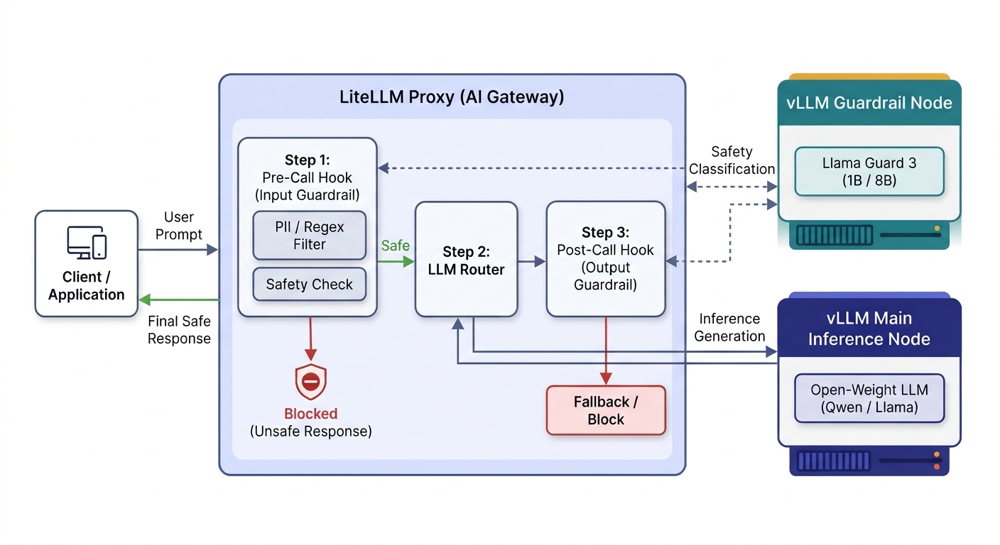
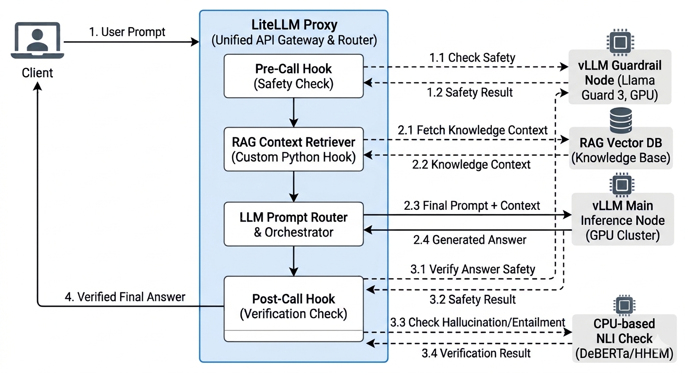

## LiteLLM 가드 레일 아키텍처 ##

가드레일은 크게 ① 경량 분류 모델(Lightweight Classification Model - Guardrail LLM) 방식과 ② 규칙/프레임워크 연동 방식으로 나뉩니다. 현재 스택에서는 두 가지를 조합하는 것이 좋다.



### 가드레일 전용 경량 모델 서빙 (vLLM 활용) ###

메인 모델 외에 보안/안전성 판별 전용 소형 모델(0.5B~8B)을 별도의 vLLM 인스턴스(또는 동일 GPU 내 소규모 메모리 할당)로 띄워 판단.
* Llama Guard 3 (1B / 8B): 메타의 최신 안전성 분류 모델로 한국어 지원 및 탈옥(Jailbreak), 유해 콘텐츠 탐지 성능이 뛰어남.
* WildGuard (7B): AllenAI에서 공개한 모델로, 프롬프트 주입(Prompt Injection)과 유해 응답 탐지에 강점.
* Qwen3-Guard / Granite Guardian: 최근 한국어 및 다국어 안전성 평가에서 가볍고 빠르게 동작.

`사용자의 입력(Input)과 메인 모델의 출력(Output)을 이 경량 모델에 먼저 보내 safe / unsafe 판정을 받은 뒤 통과`

### LiteLLM 내장 가드레일 기능 연동 (Pre/Post-call Hook) ###

LiteLLM 프록시 설정(config.yaml)만으로도 외부/내부 가드레일 엔진을 쉽게 연결할 수 있다.
* NeMo Guardrails (NVIDIA): 대화의 주제 이탈(Off-topic) 방지, 시나리오 기반 제어가 필요할 때 사용. LiteLLM에서 기본 통합을 지원.
* LLM Guard (Protect AI): 로컬에서 CPU/GPU로 빠르게 돌릴 수 있는 파이썬 기반 오픈소스 라이브러리. 개인정보(PII) 마스킹, 금칙어 필터링, 프롬프트 인젝션 탐지를 지연 시간(Latency) 최소화하며 처리하기 좋다.
* Custom Callback (자체 로직): LiteLLM의 CustomLogger 클래스를 상속받아 async_pre_call_hook(입력 검증)과 async_post_call_success_hook(출력 검증)을 직접 파이썬 코드로 작성해 위에서 띄운 Llama Guard vLLM 엔드포인트를 호출.

### 구축 단계 ###

`1. 1단계 (초기 구축)`: LiteLLM에 LLM Guard를 연동해 주민번호·전화번호 같은 개인정보(PII) 유출 방지와 기본적인 프롬프트 인젝션 차단을 먼저 적용.

`2. 2단계 (고도화)`: GPU 자원에 여유가 있다면 Llama Guard 3-8B (또는 1B)를 vLLM으로 하나 더 띄운 뒤, LiteLLM의 pre_call / post_call 훅으로 연결해 문맥상 위험한 질의응답을 차단.

`3. 비동기 처리 팁`: 출력(Output) 가드레일은 스트리밍(Streaming) 응답 시 청크(Chunk) 단위로 모아서 검사하거나, 지연 시간을 줄이기 위해 입력(Input) 가드레일만 동기(Sync)로 먼저 걸고 출력은 비동기 로깅 후 사후 차단하는 방식도 많이 쓴다.

### LiteLLM 설정 ###
```
model_list:
  # 1. 메인 추론 모델 (vLLM 서빙)
  - model_name: main-llm
    litellm_params:
      model: hosted_vllm/Qwen/Qwen2.5-72B-Instruct
      api_base: http://vllm-main:8000/v1
      api_key: "EMPTY"

  # 2. 가드레일 전용 경량 모델 (vLLM 서빙)
  - model_name: llama-guard
    litellm_params:
      model: hosted_vllm/meta-llama/Llama-Guard-3-8B
      api_base: http://vllm-guard:8001/v1
      api_key: "EMPTY"

# 가드레일 파이프라인 정의
guardrails:
  - guardrail_name: "in-house-llama-guard"
    litellm_params:
      guardrail: litellm_proxy/llama_guard  # 자체 호스팅 가드 모델 연동
      mode: ["pre_call", "post_call"]     # 입력(pre)과 출력(post) 모두 검사
      model_name: "llama-guard"           # 위 model_list에 등록한 가드레일 모델명
      default_on: true                    # 모든 요청에 기본 적용

litellm_settings:
  # 가드레일 차단 시 반환할 커스텀 메시지 설정 가능
  drop_params: true
  set_verbose: false
```


## RAG + NLI 할루시네이션 체크 가드레일 ##



### LiteLLM post_call 훅 + Cross-Encoder 검증 샘플 코드 ###

#### 1. 커스텀 가드레일 핸들러 (nli_guardrail.py) ####

CustomLogger를 상속받아 메인 LLM이 응답을 생성한 직후(async_post_call_success_hook), 검색된 문서와 생성된 답변을 Cross-Encoder로 교차 검증한다.

```
from litellm.integrations.custom_logger import CustomLogger
from sentence_transformers import CrossEncoder
from fastapi import HTTPException

class NLIGuardrail(CustomLogger):
    def __init__(self):
        # NLI(자연어 추론) 특화 Cross-Encoder 모델 로드
        self.nli_model = CrossEncoder("cross-encoder/nli-deberta-v3-small")

    async def async_post_call_success_hook(self, data: dict, user_api_key_dict, response):
        # 1. 요청 메타데이터에서 RAG로 검색된 근거 문서(Context) 추출
        retrieved_context = data.get("metadata", {}).get("retrieved_context", "")
        generated_answer = response.choices[0].message.content

        if not retrieved_context:
            return response

        # 2. Cross-Encoder에 [근거 문서, 생성 답변] 쌍을 동시에 입력하여 추론
        # 출력 라벨 순서 예시: [0: Contradiction(모순), 1: Entailment(함의), 2: Neutral(중립)]
        scores = self.nli_model.predict([(retrieved_context, generated_answer)])
        contradiction_score = scores[0][0]

        # 3. 논리적 모순(환각) 확률이 임계치(예: 0.8)를 넘으면 차단
        if contradiction_score > 0.8:
            raise HTTPException(
                status_code=400,
                detail="근거 문서와 일치하지 않는 내용(환각)이 감지되어 응답이 차단되었습니다."
            )

        return response

proxy_handler_instance = NLIGuardrail()
```


#### 2. LiteLLM 프록시 연동 설정 (config.yaml) ####

작성한 파이썬 핸들러를 callbacks에 등록하면 모든 응답 완료 후 자동으로 검증이 실행된다.
```
...
litellm_settings:
  drop_params: true
  set_verbose: false
  # 2차 가드레일: RAG + NLI 환각 정밀 검증 (출력 완료 후 실행)
  callbacks: ["nli_guardrail.proxy_handler_instance"]
```

> [!NOTE]
>  **Bi-Encoder vs Cross-Encoder: 검색과 검증의 핵심 차이**
> 
> * **Bi-Encoder (따로 인코딩 ➔ 속도 중심 · RAG 검색용)**
>   * 문서와 질문을 **각각 독립적으로 인코딩**해 문장 전체의 평균 벡터(Mean Pooling)를 생성한 뒤 벡터 간 거리를 계산.
>   * 문서 벡터를 DB에 미리 저장해 둘 수 있어 수만 건의 후보를 **초고속으로 검색**하는 데 최적화.
>   * *한계:* 단어들의 의미를 평균 내어 압축하므로 *"있다"*와 *"없다"* 같은 미세한 논리적 차이를 놓칠 수 있다.
> 
> * **Cross-Encoder (합쳐서 인코딩 ➔ 정확도 중심 · NLI 환각 검증용)**
>   * `[CLS] 근거 문서 [SEP] 생성된 답변 [SEP]` 형태로 두 문장을 **하나로 묶어 동시에 입력** 한다.
>   * 신경망 내부에서 두 문장의 모든 단어가 직접 상호작용(Self-Attention)하므로, 수치나 부정어 충돌 등 **논리적 모순(환각)을 정밀하게 판별** 한다.
>   * *특징:* 매번 실시간 교차 연산이 필요하므로 대량 검색보다는 소수의 답변을 최종 검증하는 가드레일 단계에 적합합니다.

