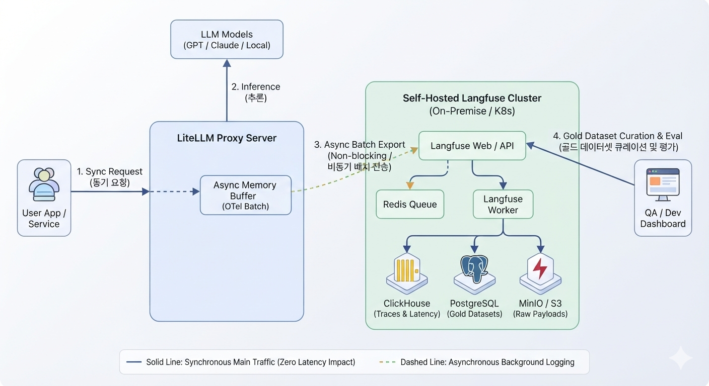
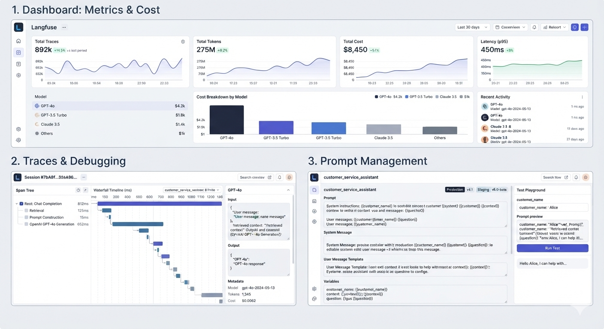

* LiteLLM에서 Langfuse로 전송되어 수집되는 데이터는 프롬프트(Input)와 모델 응답(Output) 원문, 호출된 모델명과 파라미터 설정값, 전체 응답 시간과 첫 토큰 출력 시간(TTFT), 입출력 토큰 수와 API 과금 비용, 그리고 실행 흐름을 추적하는 Trace ID와 사용자·세션별 태그 및 에러 로그 등이다.

* 이렇게 수집된 데이터는 향후 골드 데이터셋으로 구축되어, 모델의 품질 테스트와 지속적인 성능 모니터링을 수행하는 핵심 자산이 된다.



## 랭퓨즈 배포 ##

```
# 1. cert-manager 설치
helm repo add jetstack https://jetstack.io
helm install cert-manager jetstack/cert-manager \
  --namespace cert-manager --create-namespace \
  --set crds.enabled=true

# 2. ClickHouse Operator 설치 (번들 ClickHouse 사용 시 필수)
kubectl apply -f https://githubusercontent.com
```

* `langfuse-secrets.yaml`
```
apiVersion: v1
kind: Secret
metadata:
  name: langfuse-secrets
  namespace: langfuse
type: Opaque
stringData:
  # openssl rand -hex 32 로 생성한 값 입력
  salt: "YOUR_64_CHAR_HEX_SALT"
  encryptionKey: "YOUR_64_CHAR_HEX_ENCRYPTION_KEY"
  nextauthSecret: "YOUR_64_CHAR_HEX_NEXTAUTH_SECRET"
  # DB 및 스토리지 비밀번호
  postgresPassword: "YOUR_POSTGRES_PASSWORD"
  clickhousePassword: "YOUR_CLICKHOUSE_PASSWORD"
  redisPassword: "YOUR_REDIS_PASSWORD"
  s3SecretKey: "YOUR_AWS_OR_MINIO_SECRET_KEY"
```

* EKS 배포용 values.yaml
```
# values.yaml
langfuse:
  # 1. 보안 시크릿 연동 (앞서 만든 langfuse-secrets 참조)
  salt:
    secretKeyRef:
      name: langfuse-secrets
      key: salt
  encryptionKey:
    secretKeyRef:
      name: langfuse-secrets
      key: encryptionKey
  nextauth:
    url: "https://yourdomain.com" # 실제 접속 도메인으로 변경
    secret:
      secretKeyRef:
        name: langfuse-secrets
        key: nextauthSecret

  # 2. Web 및 Worker 파드 설정
  web:
    replicas: 2
    resources:
      requests:
        cpu: 500m
        memory: 1Gi
      limits:
        cpu: 2000m
        memory: 4Gi
  worker:
    replicas: 2
    resources:
      requests:
        cpu: 500m
        memory: 1Gi
      limits:
        cpu: 2000m
        memory: 4Gi

  # 3. AWS ALB Ingress 설정 (AWS Load Balancer Controller 필수)
  ingress:
    enabled: true
    className: alb
    annotations:
      alb.ingress.kubernetes.io/scheme: internet-facing # 내부망 전용이면 internal
      alb.ingress.kubernetes.io/target-type: ip
      alb.ingress.kubernetes.io/listen-ports: '[{"HTTP": 80}, {"HTTPS": 443}]'
      alb.ingress.kubernetes.io/ssl-redirect: "443"
      alb.ingress.kubernetes.io/certificate-arn: "arn:aws:acm:ap-northeast-2:123456789012:certificate/YOUR_CERT_ID" # ACM 인증서 ARN 입력
      alb.ingress.kubernetes.io/healthcheck-path: /api/public/health
    hosts:
      - host: ://yourdomain.com # 실제 접속 도메인으로 변경
        paths:
          - path: /
            pathType: Prefix

# 4. PostgreSQL 설정 (EKS 내부 배포 기준 / 외부 RDS 사용 시 deploy: false 후 host 등 입력)
postgresql:
  deploy: true
  auth:
    username: langfuse
    database: langfuse
    existingSecret: langfuse-secrets
    secretKeys:
      userPasswordKey: postgresPassword
  primary:
    persistence:
      enabled: true
      storageClass: gp3
      size: 20Gi

# 5. ClickHouse 설정 (EKS 내부 배포 - Altinity Operator 사전 설치 필요)
clickhouse:
  deploy: true
  auth:
    username: default
    existingSecret: langfuse-secrets
    existingSecretKey: clickhousePassword
  persistence:
    enabled: true
    storageClass: gp3
    size: 50Gi
  resources:
    requests:
      cpu: 1000m
      memory: 4Gi
    limits:
      cpu: 4000m
      memory: 8Gi

# 6. Redis 설정 (EKS 내부 배포 기준 / 외부 ElastiCache 사용 시 deploy: false)
redis:
  deploy: true
  auth:
    existingSecret: langfuse-secrets
    existingSecretKey: redisPassword
  primary:
    persistence:
      enabled: true
      storageClass: gp3
      size: 10Gi

# 7. S3 / 오브젝트 스토리지 설정 (EKS 내부 MinIO 기준 / 실제 AWS S3 사용 시 deploy: false 후 버킷 정보 입력)
s3:
  deploy: true
  auth:
    rootUser: minio
    existingSecret: langfuse-secrets
    rootPasswordSecretKey: s3SecretKey
  persistence:
    enabled: true
    storageClass: gp3
    size: 50Gi
  # --- 실제 AWS S3 버킷을 쓰실 경우 위를 끄고 아래 주석 해제 ---
  # deploy: false
  # endpoint: "https://amazonaws.com"
  # region: "ap-northeast-2"
  # bucket: "your-langfuse-events-bucket"
  # accessKeyId:
  #   value: "YOUR_AWS_ACCESS_KEY_ID"
  # secretAccessKey:
  #   secretKeyRef:
  #     name: langfuse-secrets
  #     key: s3SecretKey
```


배포 실행 명령어
```
# 1. 네임스페이스 생성 및 시크릿 적용
kubectl create namespace langfuse
kubectl apply -f langfuse-secrets.yaml

# 2. Langfuse 공식 Helm 레포지토리 등록 및 설치
helm repo add langfuse https://github.io
helm repo update

helm upgrade --install langfuse langfuse/langfuse \
  --namespace langfuse \
  -f values.yaml

# 3. 파드 및 ALB 주소 생성 확인
kubectl get pods -n langfuse -w
kubectl get ingress -n langfuse
```
