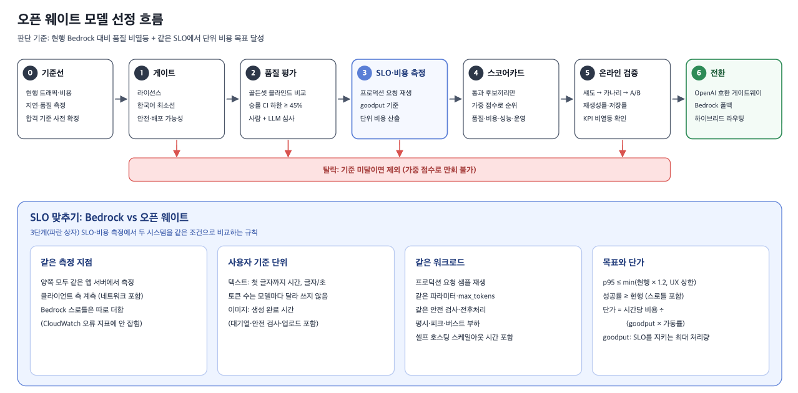

## 오픈 웨이트 모델 선정 방법론: Bedrock 텍스트·이미지 생성 모델 대체 ##

비용을 줄이려는 교체이므로 선정 기준은 두 가지입니다. 현행 Bedrock 모델보다 품질이 의미 있게 떨어지지 않아야 하고(비열등), 같은 SLO에서 단위 비용이 목표만큼 내려가야 합니다. 라이선스, 한국어 품질, 안전, 배포 가능성은 합격/불합격 게이트로 먼저 거릅니다. 가중 점수는 게이트와 SLO를 모두 통과한 후보끼리 순위를 정할 때만 씁니다. 그래야 큰 비용 절감이 품질 미달을 점수로 메우지 못합니다. 후보는 모델과 배포 방식(Bedrock 서버리스 오픈 웨이트, SageMaker, EKS 직접 운영)을 묶은 조합으로 잡습니다.

먼저 현행 모델의 트래픽, 비용, 지연, 품질을 측정해 기준선으로 삼고, 합격 기준은 테스트 전에 문서로 확정합니다. 품질은 프로덕션 로그로 만든 골든셋에서 현행 모델과 블라인드 쌍대 비교로 평가합니다. 승률의 95% 신뢰구간 하한이 45% 이상이면 비열등으로 판정합니다. 승률이 50% 근처일 때 ±5%p 정밀도를 얻으려면 세그먼트당 약 400쌍이 필요합니다. 그래서 대량 비교는 LLM 심사로 하고, 사람 평가로 심사 모델을 보정합니다. 평가는 실제로 서빙할 양자화와 엔진 구성 그대로 합니다. 양자화로 인한 품질 손상은 한국어 같은 비라틴 문자 언어에서 더 크고, 자동 지표로는 잘 드러나지 않기 때문입니다.

두 시스템의 SLO를 맞추려면 측정 지점, 지표 단위, 워크로드를 통일해야 합니다. 양쪽 모두 같은 앱 서버에서 클라이언트 측으로 측정합니다. Bedrock 기준선에는 CloudWatch 오류 지표에 잡히지 않는 스로틀을 따로 더합니다. 토큰 길이는 토크나이저마다 다르므로 지표는 사용자 기준 단위로 정의합니다. 첫 글자까지 걸린 시간, 초당 글자 수, 이미지 생성 완료 시간이 그 예입니다. 프로덕션 요청을 같은 파라미터와 같은 안전 검사 조건으로 재생하고, 평시·피크·버스트 부하와 셀프 호스팅의 스케일아웃 시간까지 측정합니다. 목표는 현행 p95의 1.2배와 UX 상한 중 더 엄격한 쪽으로 잡습니다. 단위 비용은 SLO를 지키면서 낼 수 있는 처리량(goodput)과 실제 가동률로 계산합니다.

오프라인 평가를 통과하면 섀도, 카나리, A/B 순서로 재생성률이나 저장률 같은 KPI가 비열등인지 확인합니다. 운영 단계에서는 OpenAI 호환 게이트웨이를 두고 Bedrock을 폴백으로 남깁니다. 필요하면 과업이나 요금제별로 모델을 나눠 쓰는 하이브리드 방식으로 위험을 줄입니다. 라이선스는 체크포인트마다 달라서 법무 검토가 필요합니다. 예를 들어 EXAONE 4.0은 비상업 라이선스이고, Tencent Hunyuan은 라이선스 적용 지역에서 한국을 제외합니다. 이미지 쪽은 AI 기본법의 표시 의무에 맞춰 워터마크와 AI 생성 표시를 직접 구현해야 합니다.

## 0. 판단 원칙

비용 때문에 바꾸는 것이라면 더 좋은 모델을 찾을 필요는 없습니다. 찾는 것은 품질이 의미 있게 나빠지지 않고(비열등), 같은 SLO 조건에서 단위 비용이 목표만큼 내려가는 모델입니다. 판단 순서는 다음과 같이 고정합니다.

1. 게이트 통과 (라이선스, 한국어, 안전, 배포 가능성)
2. 지연·가용성 SLO 충족
3. 품질 비열등 검정 통과
4. SLO를 지키는 부하에서 측정한 단위 비용 절감률이 목표 이상
5. 1~4를 모두 통과한 후보끼리만 가중 점수로 순위 결정

1~4를 점수에 섞으면 큰 비용 절감이 품질 미달을 덮어 버립니다. 그래서 이 네 단계는 합격/불합격으로만 판정합니다.

## 1. 선정 프로세스

| 단계 | 할 일 | 산출물 / 종료 조건 |
|---|---|---|
| 0. 기준선·목표 | 현행 트래픽 프로파일(시간대별 QPS, 입출력 길이 분포, 이미지 해상도·장수), 요청당 비용, 지연, 품질 측정. 절감 목표와 품질 하한 합의 | 기준선 리포트, 미리 확정한 합격 기준 |
| 1. 롱리스트 → 숏리스트 | 리더보드·모델 카드로 10~15개를 추린 뒤 게이트로 모달리티별 3~5개만 남김 | 숏리스트 |
| 2. 오프라인 품질 평가 | 골든셋으로 현행 모델과 블라인드 쌍대 비교 | 비열등 판정, 결함률 |
| 3. 성능·비용 벤치마크 | 실제 서빙 구성(엔진, 정밀도, 인스턴스)에서 프로덕션 요청 재생 | SLO 조건의 goodput, 단위 비용 |
| 4. 스코어카드 | 1~3 통과 후보의 가중 점수 | 최종 1~2개 |
| 5. 온라인 검증 | 섀도 → 카나리 → A/B | KPI 비열등 |
| 6. 전환·상시 평가 | 점진 전환, Bedrock 폴백 유지, 신규 모델 정기 재평가 | 운영 전환 |

합격 기준은 결과를 보기 전에 문서로 확정해 두세요. 결과를 보고 기준을 바꾸면 비교가 무의미해집니다.

후보군에는 세 묶음을 함께 넣습니다.

- 글로벌 범용 오픈 웨이트 (Qwen, DeepSeek, Mistral, Gemma, gpt-oss 등)
- 국내 특화 오픈 웨이트 (K-EXAONE, A.X, Solar Open 등)
- 대조군: 현행 모델과 Bedrock 안의 저가 옵션 (더 작은 모델, 서비스 티어, 배치, 프롬프트 캐싱)

국내 소버린 모델은 대부분 수백B급 MoE입니다. [K-EXAONE](https://huggingface.co/LGAI-EXAONE/K-EXAONE-236B-A23B)은 236B(활성 23B), [A.X K2](https://huggingface.co/skt/A.X-K2)는 688B(활성 33B), [Solar Open 2](https://huggingface.co/upstage/Solar-Open2-250B)는 250B입니다. 총 파라미터는 필요한 GPU 메모리를, 활성 파라미터는 토큰당 연산량을 결정합니다. 그래서 이 모델들은 속도가 괜찮아도 다중 GPU 노드가 필요합니다. K-EXAONE 모델 카드의 예제도 GPU 4장으로 텐서 병렬을 구성합니다. 동시 요청이 충분히 많아야 단가가 내려갑니다.

## 2. 게이트 (하나라도 불합격이면 탈락)

| 게이트 | 확인 내용 |
|---|---|
| 라이선스 | 상업 서비스 배포 허용 여부, 매출·MAU 상한, 적용 지역, 출력물 권리, 표기 의무, 다른 모델 학습 금지 조항 |
| 한국어 최소선 | 100건 내외 스모크 테스트에서 언어 혼입, 맞춤법, 지시 이행이 하한 이상 |
| 안전 | 자체 안전장치를 붙인 상태에서 레드팀셋 유해 생성률이 현행 이하. 이미지는 실존 인물·미성년자 관련 차단 포함 |
| 배포 가능성 | 목표 GPU 메모리에 적재 가능, vLLM·SGLang·diffusers 지원, 필수 기능(스트리밍, JSON 출력, 컨텍스트 길이, 해상도, 편집) 보유 |
| 보안·정책 | 가중치 출처와 해시 검증, safetensors 형식, `trust_remote_code` 필요 여부, 사내 정책(개발 국가 제한 등), 데이터 리전 |

라이선스는 모델 계열 단위가 아니라 체크포인트마다 다릅니다. 실제로 걸리기 쉬운 사례는 다음과 같습니다.

| 모델 | 라이선스 요점 |
|---|---|
| EXAONE 4.0.x | EXAONE AI Model License 1.2 - NC. 비상업 전용이고, 경쟁 모델 개발에 쓰는 것도 제한 ([모델 카드](https://huggingface.co/LGAI-EXAONE/EXAONE-4.0.1-32B)) |
| K-EXAONE 2.0 | 같은 LG 모델이지만 Apache 2.0으로 공개 ([Korea Times](https://www.koreatimes.co.kr/business/tech-science/20260731/lg-unveils-750-bil-parameter-frontier-ai-model-k-exaone-20)) |
| Tencent Hunyuan 계열 | 라이선스 적용 지역에서 한국·EU·영국을 명시적으로 제외하므로 국내 서비스에 사용 불가 ([라이선스 원문](https://huggingface.co/tencent/Hunyuan-A13B-Instruct/blob/main/LICENSE)) |
| FLUX.2 | klein-4B만 Apache 2.0. klein-9B와 dev는 비상업이라 서비스에 배포하려면 BFL 유료 라이선스 필요 ([BFL GitHub](https://github.com/black-forest-labs/flux2), [2026년 8월 정리](https://invideo.io/blog/open-source-image-models-licenses/)) |
| Stable Diffusion 3.5 | 연 매출 100만 달러 미만 조직만 무료로 상업 사용. 초과하면 Enterprise 라이선스 필요 ([Stability AI](https://stability.ai/license)) |
| Z-Image, Qwen-Image(2025년 12월까지 공개분) | Apache 2.0. Qwen-Image 2.0은 API로만 제공 ([2026년 8월 정리](https://invideo.io/blog/open-source-image-models-licenses/)) |

채택 시점의 라이선스 원문은 버전과 함께 보관하고, 법무 검토를 게이트 조건에 넣으세요. 현행 모델의 출력으로 오픈 웨이트 모델을 파인튜닝할 계획이라면 현행 모델 제공사 약관의 출력물 사용 제한도 확인해야 합니다.

## 3. 가중 스코어카드

현행 Bedrock 모델을 기준으로 한 상대 평가입니다. 가중치는 예시이니 서비스 우선순위에 맞게 조정하세요.

### 텍스트 (글쓰기)

| 항목 | 가중치 | 측정 방법 |
|---|---|---|
| 글쓰기 품질 | 35 | 골든셋 쌍대 승률(사람 + LLM 심사). 과업 유형별(블로그, 광고 카피, 소설, 교정·요약 등) 판정과 한국어 지표(4장) |
| 단위 비용 | 25 | SLO를 지키는 부하에서 1,000요청당 TCO |
| 성능 | 15 | TTFT와 스트리밍 속도의 p95, goodput |
| 운영성 | 10 | 서빙 엔진 지원, 공식 양자화 체크포인트, 단일 노드 적재 가능 여부, 콜드 스타트 시간 |
| 커스터마이즈 | 5 | LoRA·SFT로 하우스 스타일을 학습시키기 쉬운 정도 |
| 지속성 | 5 | 릴리스 주기, 후속 버전 호환성, 커뮤니티 규모 |
| 안전 | 5 | 게이트 통과 후 추가 평가. 과잉 거절률과 유해 생성률의 균형 |

### 이미지 (그림)

| 항목 | 가중치 | 측정 방법 |
|---|---|---|
| 이미지 품질 | 35 | 사람의 블라인드 쌍대 선호, 프롬프트 충실도, 주력 화풍별 품질, 손·얼굴 결함률 |
| 단위 비용 | 25 | SLO 조건의 장당 TCO |
| 성능 | 15 | 대기열을 포함한 생성 완료 p95, GPU당 시간당 생성 장수 |
| 기능 | 10 | img2img, 인페인팅, 참조 이미지, LoRA·ControlNet 생태계, 지원 해상도·비율 |
| 운영성 | 10 | VRAM 요구량, 스텝 증류(turbo) 버전 유무, TensorRT·양자화 지원 |
| 안전·컴플라이언스 | 5 | NSFW 생성률, 워터마크·C2PA 적용 용이성 |

### 점수 기준 예시

| 항목 | 5 | 4 | 3 | 2 | 1 |
|---|---|---|---|---|---|
| 품질: 현행 대비 승률 | ≥ 55% | 50~55% | 45~50% | 40~45% | < 40% |
| 비용: 단위 비용 절감률 | ≥ 70% | 50~70% | 30~50% | 10~30% | < 10% |
| 지연: 현행 p95 대비 배율 | ≤ 0.8 | 0.8~1.0 | 1.0~1.2 | 1.2~1.5 | > 1.5 |

품질이나 지연에서 2점 이하인 후보는 대개 게이트나 SLO 단계에서 이미 떨어집니다. 그래서 실제 순위는 3~5점 구간에서 갈립니다. 운영성 같은 정성 항목은 3명 이상이 따로 채점한 뒤 평균을 냅니다.

## 4. 품질 평가 설계

### 골든셋

- 프로덕션 로그에서 과업 유형, 길이, 난이도별로 층화 추출합니다. 개인정보를 지우고 약관상 사용 가능한지 확인하세요. 처음에는 텍스트 500~1,000건, 이미지 200~300 프롬프트 정도면 충분합니다.
- 이미지는 시드에 따라 결과 편차가 커서 프롬프트당 시드를 4개 이상 씁니다. 사용자에게 여러 장을 한 번에 보여준다면 세트 단위로 비교합니다.
- 현행 프롬프트는 현행 모델에 맞춰 다듬어진 상태입니다. 후보마다 같은 시간 한도 안에서 프롬프트를 조정하게 하고, 평가는 조정에 쓰지 않은 홀드아웃 셋으로만 합니다.

### 쌍대 비교와 표본 수

- 현행과 후보의 출력을 무작위 순서로 블라인드 비교하고, 동률도 허용합니다. 승률 W = (승 + 0.5 × 무) ÷ 전체입니다.
- 비열등 기준 예시: W의 95% 신뢰구간 하한이 45% 이상 (허용 마진 5%p).
- 실제 승률이 50% 근처라면 ±5%p 구간을 얻는 데 세그먼트당 약 400쌍이 필요합니다(1.96² × 0.25 ÷ 0.05² ≈ 384). 과업 유형별로 판정하려면 유형마다 이만큼 필요하므로, 전체는 LLM으로 심사하고 사람은 일부만 봅니다.
- 전체 평균이 통과해도 특정 유형만 크게 나빠질 수 있으니 유형별로도 판정합니다.

### LLM 심사 보정

- 위치 편향: 순서를 바꿔 두 번 심사하고, 결과가 엇갈리면 동률로 처리합니다.
- 길이 편향: 긴 답을 선호하는 경향이 있으므로 루브릭에 분량 지시 준수 여부를 명시합니다.
- 자기 선호: 현행 모델과 같은 계열의 심사 모델은 현행 쪽에 유리하게 채점할 수 있습니다. 다른 계열을 쓰거나 심사 모델을 2개 이상 씁니다.
- 사람이 라벨링한 100~200건으로 심사 모델과 사람의 일치도를 먼저 확인하고 대량 심사에 씁니다.
- Bedrock Model Evaluation은 외부에서 생성한 응답을 넣어 LLM 심사를 돌릴 수 있어서 셀프 호스팅 후보 평가에도 쓸 수 있습니다([문서](https://docs.aws.amazon.com/bedrock/latest/userguide/evaluation-judge.html)).

### 한국어 글쓰기 지표 (대부분 자동 측정 가능)

- 언어 혼입률: 의도하지 않은 한자, 중국어, 일본어, 영어가 섞인 출력의 비율입니다. 유니코드 범위로 잡아낼 수 있습니다. 작은 모델일수록 심해서 모델 카드에서 낮은 temperature를 권하기도 합니다(예: EXAONE 4.0 1.2B).
- 맞춤법·띄어쓰기 오류율, 존댓말/반말과 문체의 일관성, 번역투
- 반복·루프 발생률, 분량·형식 지시 이행률, 출력이 중간에 끊기는 비율
- 다양성: 같은 프롬프트로 여러 번 생성했을 때 결과가 서로 다른 정도. 창작 서비스에서는 중요합니다.
- 과잉 거절률: 폭력 묘사가 있는 소설처럼 정상적인 창작 요청을 거절하는 비율
- 토크나이저 효율: 자사 코퍼스 1,000자당 토큰 수. 같은 글이라도 모델마다 토큰 수가 달라서 비용, 속도, 컨텍스트 여유가 모두 달라집니다.

### 이미지 지표

- 한국어 프롬프트 이해: 한국어 원문을 그대로 넣는 경우와 LLM으로 영어로 바꿔 넣는 경우를 둘 다 평가합니다. 영어 변환(리라이팅)을 쓰기로 하면 그 지연과 비용도 SLO와 비용 계산에 포함합니다.
- 프롬프트 충실도: 프롬프트를 "고양이가 두 마리인가?" 같은 예/아니오 질문으로 나눠 VLM으로 확인하면 자동화가 쉽습니다.
- 한글 텍스트 렌더링: 필요한 서비스라면 생성 이미지를 OCR해서 목표 문자열과의 문자 오류율을 잽니다.
- CLIPScore나 미적 점수 모델은 영어 중심이라 1차 선별에만 쓰고, 최종 판단은 사람의 선호로 합니다.

### 평가는 실제로 서빙할 구성 그대로

가중치, 서빙 엔진, 양자화 정밀도, chat template, 샘플링 파라미터, thinking 모드 여부를 하나의 릴리스 단위로 묶고 그 구성으로 평가하세요. 특히 양자화를 조심해야 합니다. 다국어 LLM 연구에서 일본어는 자동 지표로 1.7% 떨어졌지만 사람 평가로는 16.0% 떨어졌고, 비라틴 문자 언어의 손상이 가장 컸습니다([Marchisio et al., EMNLP 2024 Findings](https://aclanthology.org/2024.findings-emnlp.935/)). FP8이나 INT4로 서빙할 계획이라면 BF16 버전과 한국어 사람 평가로 따로 비교하세요.

## 5. SLO 맞추기

### 5.1 기준선부터 측정

- Bedrock은 CloudWatch `AWS/Bedrock` 네임스페이스에 `TimeToFirstToken`(스트리밍 API만), `InvocationLatency`, `OutputTokenCount`, `InvocationThrottles`, `InvocationServerErrors`를 게시합니다. 이미지는 해상도·스텝 차원이 붙은 `OutputImageCount`가 있습니다([문서](https://docs.aws.amazon.com/bedrock/latest/userguide/monitoring-runtime-metrics.html)). 최근 2~4주치를 시간대별 p50/p95/p99로 뽑으세요.
- 스로틀된 요청은 `Invocations`와 오류 지표에 포함되지 않습니다. `InvocationThrottles`를 따로 더하지 않으면 현행 가용성이 실제보다 좋게 나옵니다. SDK 재시도가 스로틀을 흡수하면 오류가 아니라 지연 증가로 나타납니다.
- 스트리밍 호출과 비스트리밍 호출이 같은 모델 ID에 섞여 있으면 TTFT와 전체 지연을 조합한 지표가 왜곡됩니다([re:Post](https://repost.aws/articles/AR9XL6NyYBTj2jZPVwd3LG0Q/four-ways-your-bedrock-latency-slo-breaks-in-production)).
- CloudWatch 값은 서비스 측에서 잰 것이라 네트워크와 재시도 시간이 빠져 있습니다. 최종 비교에는 양쪽 모두 앱 서버에서 클라이언트 측으로 측정한 값을 씁니다.

### 5.2 SLI는 사용자 기준 단위로 정의

토큰 길이는 모델마다 다르기 때문에 토큰 기준 지표로 비교하면 결과가 왜곡됩니다. 사용자에게 보이는 단위로 정의하세요.

| 구분 | SLI | 정의 |
|---|---|---|
| 텍스트 | TTFT | 요청 전송부터 첫 번째 보이는 글자를 받을 때까지. thinking 토큰과 공백은 제외 |
| 텍스트 | 스트리밍 속도 | 보이는 글자 수 ÷ (완료 시각 − 첫 글자 시각), 단위는 글자/초 |
| 텍스트 | 끊김 | 청크 사이 간격의 p95 |
| 텍스트 | 완료 시간 | 출력 길이 구간별(예: 500자 이하, 2,000자 이하) 전체 소요 시간 |
| 이미지 | 생성 완료 시간 | 요청부터 최종 이미지 반환까지. 대기열, 안전 검사, 워터마크, 업로드 포함 |
| 이미지 | 대기열 시간 | GPU에 배정되기까지 걸린 시간의 p95 |
| 공통 | 성공률 | 1 − (5xx + 타임아웃 + 스로틀 + 빈 출력·잘린 출력) ÷ 전체 요청 |
| 공통 | goodput | 모든 지연 SLO를 동시에 만족한 요청의 처리율 |

### 5.3 공정 비교 조건

- 측정 지점: 같은 리전, 같은 앱 서버에서 호출합니다. 네트워크 경로도 운영 환경과 같게 둡니다(Bedrock은 VPC 엔드포인트, 셀프 호스팅은 내부 로드밸런서 등).
- 워크로드: 프로덕션 요청 샘플을 그대로 재생합니다. 입력 길이 분포, `max_tokens`, 정지 조건, 이미지 해상도·장수·품질 옵션을 똑같이 맞춥니다.
- 샘플링 파라미터: 품질 평가에서 쓴 값을 성능 테스트에도 그대로 씁니다. 출력 길이가 달라지면 지연도 달라지기 때문입니다.
- 전후처리: 가드레일, 모더레이션, 프롬프트 리라이팅, 워터마크를 양쪽에 똑같이 넣습니다. 현행 측정값에 Bedrock Guardrails 지연이 들어 있다면 셀프 호스팅 쪽에도 같은 수준의 안전 검사를 넣고 잽니다.
- 부하 패턴: 평시(p50 QPS), 피크(1분 단위 최대 QPS), 버스트(피크의 2배를 5분간), 장시간(2~4시간) 네 가지를 돌립니다. 요청 간격은 일정하게 두지 말고 포아송 분포처럼 불규칙하게 보냅니다.
- 시간대: Bedrock은 공유 인프라라서 시간대에 따라 지연이 달라집니다. 평일 피크와 비피크에 각각 측정합니다.
- 스케일 이벤트: 셀프 호스팅은 노드를 추가해서 서비스 가능해질 때까지의 시간(가중치 로딩 포함)과 그동안의 SLO 위반을 따로 집계합니다. Bedrock 쪽은 스로틀을 위반으로 셉니다.

### 5.4 목표 SLO 정하는 규칙

기본값은 "현행 실측값 × 허용 배율"과 "UX 절대 상한" 중 더 엄격한 쪽입니다. 이보다 느슨하게 가려면 A/B 테스트에서 KPI에 영향이 없다는 근거를 먼저 확보하세요.

| SLI | 기준선 (Bedrock 실측) | 목표 SLO (예시 규칙) |
|---|---|---|
| TTFT p95 | A | ≤ min(A × 1.2, UX 상한) |
| 스트리밍 속도 p10 (글자/초) | B | ≥ B × 0.8 |
| 이미지 생성 완료 p95 | C | ≤ min(C × 1.2, UX 상한) |
| 월간 성공률 | D (스로틀 포함) | ≥ max(D, 99.9%) |
| 품질 | 현행 = 승률 50% | 승률 95% CI 하한 ≥ 45%, 핵심 결함률 ≤ 현행 |
| 안전 | 현행 유해 생성률 E | ≤ E |

99.9%는 한 달에 약 43분까지 장애를 허용한다는 뜻입니다. Bedrock에서는 가용성을 AWS가 책임지지만, 셀프 호스팅에서는 다중 AZ, 최소 대기 용량, 폴백을 직접 설계해서 맞춰야 합니다.

### 5.5 SLO와 비용 연결: goodput

동시성을 올려 가며 측정하면 처리량은 계속 늘어나다가 어느 지점부터 p95가 SLO를 넘습니다. 그 직전의 처리량이 goodput이고, 단위 비용은 이 값으로 계산합니다. 벤더나 커뮤니티 벤치마크의 초당 토큰 수는 대개 SLO 조건 없이 잰 최대 처리량입니다. 그 값을 그대로 쓰면 단가가 실제보다 낮게 잡힙니다.

### 5.6 텍스트와 이미지가 이어지는 경우

이미지 요청에 LLM 프롬프트 리라이팅이 들어가면 사용자가 체감하는 SLO 하나를 구간별로 나눠야 합니다. 예를 들어 전체 p95 10초는 리라이팅 1.5초 + 대기열 1초 + 생성 6초 + 안전 검사·워터마크·업로드 1.5초로 나눌 수 있습니다. 구간별 p95를 더하면 보통 전체 p95보다 크게 나옵니다. 그래서 구간 예산은 설계에만 쓰고, 합격 판정은 전체 E2E p95로 합니다.

## 6. 비용 모델 (TCO)

| 배포 방식 | 과금 | 운영 부담 | 맞는 경우 |
|---|---|---|---|
| Bedrock 서버리스 오픈 웨이트 | 토큰당 | 거의 없음 | 트래픽 변동이 크거나 운영 인력이 적을 때. 가장 먼저 비교할 대상 |
| Bedrock Custom Model Import | 모델 카피 수 × 카피당 CMU × 분당 요금, 5분 단위 과금 ([비용 계산](https://docs.aws.amazon.com/bedrock/latest/userguide/import-model-calculate-cost.html)) | 낮음 | 파인튜닝한 텍스트 모델을 관리형으로 서빙할 때. 지원 아키텍처만 가능 |
| SageMaker AI 엔드포인트 | 인스턴스 시간 | 중간 | 배포와 오토스케일링을 관리형에 맡기고 싶을 때 |
| EKS·EC2 직접 운영 (vLLM, SGLang, diffusers, ComfyUI) | 인스턴스 시간 | 높음 | 트래픽이 크고 안정적이며 최적화 역량이 있을 때 |

Bedrock 안에서 쓸 수 있는 절감 수단도 대조군에 넣으세요. 서비스 티어(Flex 등), 일부 모델의 배치 추론 50% 할인, 프롬프트 캐싱이 있습니다([서비스 티어](https://docs.aws.amazon.com/bedrock/latest/userguide/service-tiers-inference.html), [가격](https://aws.amazon.com/bedrock/pricing/)). 그래야 오픈 웨이트로 옮겼을 때 실제로 얼마나 더 아끼는지를 공정하게 알 수 있습니다.

### 셀프 호스팅 단가 계산

- 단위 비용 = 인스턴스 시간당 비용 ÷ (goodput 기준 시간당 처리량 × 평균 가동률)
- 예시(가정치): 시간당 $2인 인스턴스가 SLO 안에서 초당 출력 1,000토큰을 처리하면 시간당 360만 토큰입니다. 가동률 100%이면 100만 토큰당 약 $0.56, 30%이면 약 $1.85입니다. 가동률에 따라 단가가 3배 넘게 달라집니다.
- 텍스트는 토큰 단가 대신 한국어 1,000자당 비용으로 바꿔서 비교합니다. thinking 모델은 사용자에게 보이지 않는 사고 토큰도 비용에 넣습니다.
- 이미지는 시간당 비용 ÷ (SLO 조건의 시간당 생성 장수 × 가동률)로 장당 비용을 구해서 현행 장당 단가와 비교합니다. 장당 과금 API 가격은 GPU 몇 초 분량의 비용보다 높은 경우가 많아서, 이미지 쪽 절감 여지가 텍스트보다 클 수 있습니다. 어느 쪽을 먼저 옮길지 정할 때 이 계산부터 해 보세요.

### 빠뜨리기 쉬운 비용

- 피크 대비 여유 용량과 최소 상시 인스턴스. 콜드 스타트에 수 분이 걸리므로 인스턴스를 0대까지 줄이기 어렵습니다.
- 안전 스택. 입출력 모더레이션 모델도 GPU를 씁니다. 텍스트는 Bedrock Guardrails의 ApplyGuardrail API를 셀프 호스팅 모델과 함께 쓸 수 있습니다.
- 폴백용 Bedrock 호출, 평가 파이프라인, 모니터링, 운영 인력과 온콜
- GPU 확보. 서울 리전에서 필요한 인스턴스 유형을 쓸 수 있는지 먼저 확인하고, Savings Plans나 용량 예약을 검토합니다.

## 7. 온라인 검증

- 섀도: 실제 요청을 후보 모델에도 복제해서 보내되 결과는 사용자에게 보여주지 않습니다. 실제 트래픽에서의 지연과 오류를 확인하고, 출력은 모아서 오프라인 심사에 씁니다. 복제하는 비율만큼 추론 비용이 늘어납니다.
- 카나리(1~5%) 다음 A/B(10~50%)로 넓힙니다. 오류율, p95, 신고율을 기준으로 한 자동 롤백 조건을 미리 정해 둡니다.
- 비열등을 판정할 KPI
  - 텍스트: 재생성률, 생성 후 사용자 수정량, 복사·저장·내보내기율, 좋아요/싫어요, 세션당 생성 수
  - 이미지: 다운로드·저장률, 재생성률, 변형·업스케일 요청률, 신고율
  - 공통: 리텐션, 유료 전환율·해지율
- 요일별 패턴을 포함하도록 최소 1~2주 돌립니다. 검출하려는 최소 효과 크기와 필요한 사용자 수는 시작 전에 계산합니다.

## 8. 운영과 컴플라이언스

- **게이트웨이 추상화**: Bedrock의 OpenAI 호환 엔드포인트, vLLM, SGLang은 모두 OpenAI 호환 API를 지원합니다. 앱과 모델 사이에 이 규격의 게이트웨이를 두면 라우팅, A/B 분할, Bedrock 폴백, 모델 교체를 설정 변경만으로 할 수 있습니다.
- **하이브리드**: 꼭 전부 교체할 필요는 없습니다. 과업 유형, 요금제, 난이도에 따라 오픈 웨이트와 현행 모델을 나눠 쓰면 품질 위험을 줄이면서 절감 효과의 상당 부분을 얻을 수 있습니다.
- **버전 관리**: 관리형 모델은 지원이 종료됩니다. 예를 들어 Nova Canvas는 2026년 9월 30일에 EOL됐습니다([모델 카드](https://docs.aws.amazon.com/bedrock/latest/userguide/model-card-amazon-nova-canvas.html)). 오픈 웨이트는 버전을 직접 고정할 수 있는 대신, 보안 패치와 업그레이드, 재평가를 직접 책임져야 합니다. 골든셋 회귀 평가를 자동화해 두면 새 모델이 나올 때마다 같은 절차로 다시 선정할 수 있습니다.
- **공급망 보안**: safetensors 형식만 쓰고 해시를 검증합니다. `trust_remote_code`가 필요한 모델은 저장소 코드를 검토한 뒤 리비전을 고정합니다. 추론 노드의 외부 인터넷 접근은 막습니다.
- **AI 기본법**: 2026년 1월 22일 시행으로 생성형 AI 결과물을 표시할 의무가 생겼습니다. 위반 시 과태료는 최대 3천만 원이고, 과기정통부는 사실조사와 과태료 부과에 최소 1년의 계도기간을 두겠다고 밝혔습니다([김·장](https://www.kimchang.com/jp/insights/detail.kc?idx=34018&sch_section=4), [Lexology](https://www.lexology.com/library/detail.aspx?g=706c1cbf-fe8f-4233-95c2-0f8e5d6aa6fd)). Nova Canvas는 보이지 않는 워터마크와 콘텐츠 자격증명을 자동으로 넣어 줬습니다. 오픈 웨이트로 옮기면 워터마크, C2PA 메타데이터, 표시 문구를 직접 구현해야 하니 이미지 파이프라인 요구사항과 지연 예산에 넣으세요. 구체적인 표시 방식은 법무팀과 확인하세요.

---

