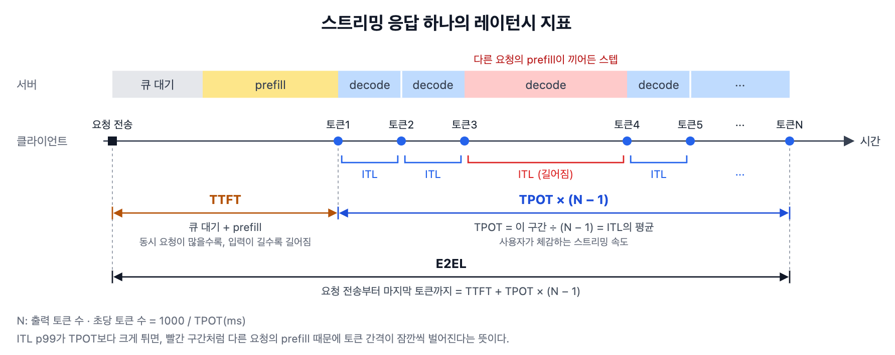

## 모델 레이턴시 측정 ##

vLLM 서비스는 ClusterIP 타입이라 클러스터 외부에서는 접속할 수 없다. 그래서 클러스터 안에 벤치마크 파드를 띄우고, 그 파드에서 서비스 DNS(`gemma4-12b-vllm.llm-serving.svc.cluster.local:8000`)로 직접 요청을 보낸다. 도구는 vLLM에 들어 있는 `vllm bench serve`를 쓴다. 서버와 같은 이미지에 포함돼 있어 따로 설치할 것이 없고, TTFT·TPOT·ITL·E2E 지연을 백분위수로 보여 준다.

`kubectl port-forward`로도 접속은 된다. 하지만 요청이 API 서버와 kubelet을 거치는 터널로 전달되므로 지연이 더해지고, 동시 요청이 많아지면 터널이 먼저 병목이 된다. 응답이 오는지 확인하는 용도로만 쓰는 게 좋다.

### 1. 벤치마크 파드 실행 ###

동시 요청 수를 1에서 64까지 늘려 가며 차례로 측정하는 파드를 만든다. 측정이 끝나도 결과 파일을 꺼낼 수 있게 파드는 계속 떠 있다. 스크립트 안의 `${...}`가 로컬 셸에서 치환되지 않도록 heredoc을 `<<'EOF'`로 감쌌다.

```
kubectl apply -f - <<'EOF'
apiVersion: v1
kind: Pod
metadata:
  name: vllm-bench
  namespace: llm-serving
spec:
  restartPolicy: Never
  containers:
    - name: bench
      image: vllm/vllm-openai:v0.33.0            # 서버와 같은 이미지 (vllm bench serve 포함)
      command: ["bash", "-c"]
      args:
        - |
          mkdir -p /tmp/results
          for C in ${CONCURRENCY}; do
            N=$(( C * 10 > 50 ? C * 10 : 50 ))     # 요청 수: 동시성 x 10, 최소 50
            echo "===== concurrency=${C} prompts=${N} ====="
            vllm bench serve \
              --backend openai-chat \
              --endpoint /v1/chat/completions \
              --base-url "${TARGET_URL}" \
              --model gemma-4-12b \
              --tokenizer RedHatAI/gemma-4-12B-it-FP8-Dynamic \
              --dataset-name random \
              --random-input-len "${ISL}" \
              --random-output-len "${OSL}" \
              --ignore-eos \
              --max-concurrency "${C}" \
              --num-prompts "${N}" \
              --num-warmups 3 \
              --seed "$(date +%s)" \
              --percentile-metrics ttft,tpot,itl,e2el \
              --metric-percentiles 50,90,99 \
              --disable-tqdm \
              --save-result --result-dir /tmp/results --result-filename "c${C}.json"
          done
          echo "===== done ====="
          sleep infinity                             # kubectl cp로 결과를 꺼낼 때까지 유지
      env:
        - name: TARGET_URL
          value: http://gemma4-12b-vllm.llm-serving.svc.cluster.local:8000
        - name: ISL                                  # 요청당 입력 토큰 수
          value: "1024"
        - name: OSL                                  # 요청당 출력 토큰 수
          value: "256"
        - name: CONCURRENCY                          # 측정할 동시 요청 수
          value: "1 2 4 8 16 32 64"
        - name: HF_HOME                              # 토크나이저 캐시 위치
          value: /tmp/hf
        - name: PYTHONUNBUFFERED                     # kubectl logs에 결과가 바로 보이게
          value: "1"
      resources:
        requests:
          cpu: "2"
          memory: 4Gi
        limits:
          memory: 4Gi
EOF
```

- **프롬프트:** 랜덤 토큰으로 만든다. `--ignore-eos`로 출력 길이를 `OSL`에 고정해야 실행끼리 비교할 수 있다. Hugging Face에서는 토크나이저 파일만 받는다.
- **seed:** seed가 같으면 같은 프롬프트가 만들어진다. 기본값(0)을 그대로 쓰면 앞에서 보낸 프롬프트가 다시 나갈 수 있다. 서버에 `--enable-prefix-caching`이 켜져 있어서 이런 요청은 캐시에 적중하고, TTFT가 실제보다 낮게 나온다. 그래서 단계마다 `$(date +%s)`로 seed를 바꾼다.

### 2. 진행 확인과 결과 정리 ###

```
kubectl wait -n llm-serving --for=condition=Ready pod/vllm-bench --timeout=10m
kubectl logs -n llm-serving -f vllm-bench
```

동시성마다 `Serving Benchmark Result` 표가 출력된다. `===== done =====`이 보이면 결과 JSON을 꺼내서 한 표로 모은다. 시간 단위는 ms다.

```
kubectl cp llm-serving/vllm-bench:/tmp/results ./bench-results

jq -rs '
  sort_by(.max_concurrency)
  | (["conc","fail","req/s","out_tok/s","TTFT_p50","TTFT_p99","TPOT_p50","TPOT_p99","ITL_p99","E2E_p50","E2E_p99"] | @tsv),
    (.[] | [.max_concurrency, .failed,
            (.request_throughput * 100 | round / 100),
            (.output_throughput | round),
            (.median_ttft_ms | round), (.p99_ttft_ms | round),
            (.median_tpot_ms * 10 | round / 10), (.p99_tpot_ms * 10 | round / 10),
            (.p99_itl_ms * 10 | round / 10),
            (.median_e2el_ms | round), (.p99_e2el_ms | round)] | @tsv)
' bench-results/c*.json | column -t
```

[결과]
```
conc  fail  req/s  out_tok/s  TTFT_p50  TTFT_p99  TPOT_p50  TPOT_p99  ITL_p99  E2E_p50  E2E_p99
1     0     0.17   43         111       120       23        23        23.8     5974     5985
2     0     0.33   83         137       222       23.3      23.6      24.2     6148     6165
4     0     0.59   152        319       414       24.2      25        25       6497     6521
8     0     1.12   286        490       706       26.2      27.5      33.8     7158     7222
16    0     1.89   483        578       1496      30.8      32.7      192.9    8440     9250
32    0     2.89   739        634       2789      40.8      42.8      223.7    11014    12977
64    0     4.03   1032       688       5535      59.1      61.1      230.2    15792    20499
```

`fail`이 0이 아니면 vLLM 서버 로그(`kubectl logs -n llm-serving deploy/gemma4-12b-vllm`)를 확인한다. 요청별 에러 메시지가 필요하면 `--save-detailed`를 추가해 다시 돌린다. 에러 메시지는 결과 JSON의 `errors` 필드에 남는다.


### 3. 결과 읽는 법 ###


* 위쪽 막대: 서버가 하는 일을 순서대로 보여 준다. 큐 대기, prefill, decode 순서이고, decode 한 칸에서 토큰이 하나 나온다.
* 가운데 점: 클라이언트에 토큰이 도착한 시각으로 점과 점 사이의 간격 하나하나가 ITL이다.
* 빨간 칸: 다른 요청의 prefill이 같은 스텝에 끼어들어 그 스텝이 길어진 경우로 토큰3과 토큰4 사이의 ITL이 길어졌다.
* 아래 화살표: TTFT와 TPOT × (N − 1)을 더하면 E2EL이다.

| 지표 | 의미 | 해석 |
|---|---|---|
| TTFT (Time To First Token) | 요청을 보낸 뒤 첫 토큰을 받을 때까지의 시간 | 큐 대기와 프롬프트 처리(prefill) 시간이 합쳐진 값이다. 입력이 길수록, 동시 요청이 많을수록 커진다. |
| TPOT (Time Per Output Token) | 첫 토큰 이후 토큰 하나당 평균 시간 | 사용자가 체감하는 스트리밍 속도다. 1000 / TPOT(ms)가 초당 토큰 수다. |
| ITL (Inter-Token Latency) | 연속한 두 토큰 사이의 간격 | p99가 TPOT보다 크게 튀면 다른 요청의 prefill이 같은 스텝에 끼어들어 토큰 간격이 잠깐씩 벌어진다는 뜻이다. |
| E2EL (End-to-End Latency) | 요청 하나가 끝날 때까지 걸린 전체 시간 | 대략 TTFT + TPOT x (출력 토큰 수 - 1)이다. |

동시성 1의 결과가 이 GPU에서 낼 수 있는 최저 지연이다. 디코딩은 토큰을 하나 만들 때마다 모델 가중치 전체를 GPU 메모리에서 읽는다. 가중치는 12.75GiB(기동 로그의 `Model loading took` 값)이고 L40S의 메모리 대역폭은 864GB/s이므로, TPOT의 이론 하한은 약 16ms다. 실제로는 스펙 대역폭을 다 쓰지 못하고 KV 캐시도 함께 읽으므로 측정값은 이보다 크게 나온다.

동시성을 올리면 여러 요청이 한 스텝에 묶여 처리되고, 가중치는 그 스텝에서 한 번만 읽는다. 그래서 처음에는 TPOT가 조금만 늘고 처리량(`out_tok/s`)은 크게 늘어난다. 어느 지점을 넘으면 TTFT와 TPOT가 가파르게 커진다.

목표 SLO(예: TTFT p99 1초, TPOT p99 50ms)를 지키는 가장 큰 동시성이 파드 하나가 감당할 수 있는 양이고, 나중에 오토스케일링 기준으로 쓰면 된다. 스크립트에 `--goodput ttft:1000 tpot:50`을 추가하면 SLO를 지킨 요청만 센 처리량(`Request goodput (req/s)`)도 함께 출력된다.

### 4. 조건을 바꿔 다시 측정할 때 ###

- **길이 바꾸기:** 파드 스펙은 만든 뒤에 수정할 수 없다. 결과를 `kubectl cp`로 꺼낸 다음 `kubectl delete pod vllm-bench -n llm-serving`으로 지우고, `ISL`, `OSL`, `CONCURRENCY` 값을 바꿔 다시 apply 한다. 결과는 조건마다 다른 디렉터리로 꺼낸다(예: `./bench-results-4096-512`). TTFT는 입력 길이에 따라 크게 달라지므로 실제 트래픽의 길이에 맞춰 측정해야 한다(예: 채팅 1024/256, RAG 4096/512).
- **도착 방식:** 위 측정은 동시 요청 수를 고정하는 방식이다. 초당 요청 수 기준으로 보려면 `--max-concurrency` 대신 `--request-rate`(예: `--request-rate 2`)를 준다. 그러면 요청이 포아송 분포로 도착한다. 이때 결과 JSON의 `max_concurrency`는 null이 되므로 요약 jq는 `.request_rate` 기준으로 바꾼다.
- **프록시 추가 후:** 나중에 LiteLLM이나 ALB를 앞에 붙이면 `TARGET_URL`을 바꿔서 같은 측정을 한다. 프록시에 API 키를 걸었다면 파드 env에 `OPENAI_API_KEY`를 넣는다. `vllm bench serve`가 이 값을 `Authorization: Bearer` 헤더로 보낸다. 프록시에 등록한 모델 이름이 다르면 `--model`도 바꾼다. 이번 결과와의 차이가 프록시 계층이 더한 지연이다.
- **정리:** 측정이 끝나면 `kubectl delete pod vllm-bench -n llm-serving`으로 파드를 지운다.

### 5. 주의할 점 ###
여기서 Ready는 벤치마크가 끝났다는 뜻이 아닙니다. 컨테이너가 시작됐다는 뜻이다.

* vllm-bench 파드에는 readinessProbe가 없다. 그래서 컨테이너가 실행되자마자 Ready가 된다.
* vLLM 서버 파드는 다르다. readinessProbe로 /health를 확인하므로 모델 로딩이 끝나야 Ready가 된다.
벤치마크가 끝났는지는 로그에 ===== done =====이 찍혔는지로 확인한다.

타임아웃이 나면 kubectl describe pod vllm-bench -n llm-serving을 실행해 Events에서 원인을 찾는다.

* 아직 Pulling 중일 때: 이미지를 받는 중이니 같은 kubectl wait 명령을 다시 실행한다.
* ErrImagePull, ImagePullBackOff, FailedScheduling일 때: 기다려도 해결되지 않는다. 이미지 받기 실패나 노드 자원 부족 같은 원인을 먼저 고쳐야 한다.


## 측정 결과 해석 ##

g6e.4xlarge(L40S 48GB 1장)에서 vLLM v0.33.0으로 gemma-4-12B-it-FP8-Dynamic을 측정한 결과다. 요청당 입력은 1024토큰, 출력은 256토큰이고, 동시성마다 요청 수는 `max(동시성 × 10, 50)`개다.

[결과]
```
conc  fail  req/s  out_tok/s  TTFT_p50  TTFT_p99  TPOT_p50  TPOT_p99  ITL_p99  E2E_p50  E2E_p99
1     0     0.17   43         111       120       23        23        23.8     5974     5985
2     0     0.33   83         137       222       23.3      23.6      24.2     6148     6165
4     0     0.59   152        319       414       24.2      25        25       6497     6521
8     0     1.12   286        490       706       26.2      27.5      33.8     7158     7222
16    0     1.89   483        578       1496      30.8      32.7      192.9    8440     9250
32    0     2.89   739        634       2789      40.8      42.8      223.7    11014    12977
64    0     4.03   1032       688       5535      59.1      61.1      230.2    15792    20499
```

모든 단계에서 실패한 요청은 0건이다. 동시성 8까지는 TPOT가 14%만 늘고 TTFT p99도 1초 안에 머물면서 처리량이 6.7배 늘었다. 16부터는 요청이 몰릴 때 첫 토큰을 기다리는 시간(TTFT p99)과 스트리밍 끊김(ITL p99)이 커진다. 64에서도 처리량은 계속 늘고 있어 아직 한계에 닿지 않았지만, 그 대가로 지연이 크게 나빠진다.

### 1. 처리량을 얻는 대신 사용자 한 명의 속도가 줄어든다 ###

| 동시성 | 1 | 8 | 16 | 32 | 64 |
|---|---|---|---|---|---|
| 사용자 한 명이 받는 속도 (토큰/초, 1000 / TPOT_p50) | 43 | 38 | 32 | 25 | 17 |
| GPU 전체 처리량 (out_tok/s) | 43 | 286 | 483 | 739 | 1032 |

- **동시성 1 (기준선):** TPOT 23ms는 앞에서 계산한 이론 하한(약 16ms)의 약 1.4배다. 메모리 대역폭을 스펙의 70% 정도 쓰는 셈이므로 정상 범위다. E2E 5974ms도 TTFT 111ms + 23ms × 255와 맞는다.
- **동시성 1→8:** TPOT는 14%만 늘었는데 처리량은 6.7배가 됐다. 스텝마다 가중치를 한 번 읽어 여러 요청에 함께 쓰기 때문이다.
- **동시성 64:** 처리량은 동시성 1의 24배지만, 사용자 한 명은 초당 17토큰밖에 받지 못한다.

### 2. TTFT p99는 동시성에 비례한다 ###

| 동시성 | 8 | 16 | 32 | 64 |
|---|---|---|---|---|
| TTFT_p99 (ms) | 706 | 1496 | 2789 | 5535 |
| TTFT_p99 ÷ 동시성 (ms) | 88 | 94 | 87 | 86 |

나눈 값이 87ms 안팎으로 일정하다. 입력 1024토큰짜리 prefill 하나에 약 87ms가 걸리고, 요청 C개가 한꺼번에 오면 마지막 요청은 앞 요청들의 prefill이 다 끝날 때까지 기다린다는 뜻이다.

이 벤치마크는 동시성 단계마다 요청 C개를 동시에 보내면서 시작한다. 동시성 8 이상에서는 전체 요청 수가 C의 10배라서 이 첫 묶음이 전체의 10%를 차지하고, p99 값은 첫 묶음의 마지막 요청들이 결정한다. 그래서 TTFT p99는 "요청 C개가 동시에 몰렸을 때 마지막 사용자가 기다린 시간"으로 읽으면 된다. 몰리지 않은 보통 요청의 대기 시간은 p50 값(0.5~0.7초)에 가깝다.

### 3. ITL p99는 16에서 뛰어오르고 230ms 근처에서 멈춘다 ###

ITL p99는 동시성 8까지 TPOT와 비슷한 24~34ms다. 16에서 192.9ms로 뛰고, 그 뒤로는 190~230ms에 머문다.

- **값이 튀는 이유:** 다른 요청의 prefill이 같은 스텝에 끼어들면 그 스텝이 길어진다. 동시성 8에서 ITL p99가 33.8ms라는 것은 이렇게 길어진 간격이 전체 간격의 1%보다 적었다는 뜻이다. 16부터는 1%를 넘었다.
- **230ms 근처에서 멈추는 이유:** 한 스텝에서 처리하는 토큰 수에는 상한(`max_num_batched_tokens`)이 있다. prefill이 아무리 많이 밀려 있어도 한 스텝에는 이 상한만큼만 들어가고 나머지는 다음 스텝으로 넘어가므로, 스텝 하나가 길어질 수 있는 한도도 정해져 있다. v0.33.0에서 메모리 70GiB 미만 GPU의 기본값은 2048이다. 2048토큰 prefill 시간(87ms × 2 ≈ 175ms)에 decode 시간을 더하면 측정값과 비슷하므로, 이 상한 때문에 멈춘 것으로 보인다.
- **실제 값 확인:** Gemma 4처럼 이미지 입력을 받는 모델은 이 값이 자동으로 올라갈 수 있으니 서버 로그에서 확인한다.

```
kubectl logs -n llm-serving deploy/gemma4-12b-vllm | grep max_num_batched_tokens
```

[vLLM 최적화 문서](https://docs.vllm.ai/en/stable/configuration/optimization/)에 따르면 이 값을 줄이면 ITL이 좋아지고, 늘리면 TTFT가 좋아진다.

### 4. TPOT가 16부터 빨리 늘어나는 이유 ###

원인은 두 가지다. 요청이 많을수록 스텝마다 읽어야 할 KV 캐시가 늘어 decode 스텝 자체가 느려진다. 그리고 다른 요청의 prefill이 더 자주 끼어든다.

동시성 64를 예로 어림해 보면, 한 요청이 답을 받는 약 15.8초 동안 새 요청이 약 64개(4.03 req/s × 15.8초) 들어온다. 이 요청들의 prefill 시간(64 × 87ms ≈ 5.6초)을 출력 토큰 255개로 나누면 토큰당 약 22ms다. 즉 TPOT 59ms 중 약 3분의 1이 다른 요청의 prefill이 끼어들어 생긴 시간이다. RAG처럼 입력이 긴 워크로드에서는 이 비중이 더 커진다.

### 5. 운영 기준으로 바꾸기 ###

먼저 목표 지연(SLO)을 정하고, 그 목표를 지키는 가장 큰 동시성을 고른다. 목표는 서비스마다 다르며, 아래는 예시다.

| 목표 (예시) | 지키는 최대 동시성 | 그때 처리량 |
|---|---|---|
| TTFT p99 ≤ 1초, ITL p99 ≤ 50ms (빠르고 끊김 없는 대화) | 8 | 1.12 req/s, 286 tok/s |
| TTFT p99 ≤ 3초, TPOT p99 ≤ 50ms (조금 느슨한 대화, 0.2초 정도의 끊김은 허용) | 32 | 2.89 req/s, 739 tok/s |
| 지연보다 처리량이 중요 (배치 작업) | 64 이상 | 64에서 4.03 req/s, 1032 tok/s (더 늘어날 여지 있음) |

이렇게 고른 동시성이 파드 하나에 맡길 동시 요청 수의 상한이다. 예를 들어 첫 번째 목표를 쓴다면, 파드당 실행 중인 요청 수(vLLM 메트릭 `vllm:num_requests_running`)가 8을 넘을 때 파드를 늘리도록 오토스케일링 기준을 잡는다. 여유를 두려면 기준을 이보다 조금 낮게 잡는다.

### 6. 다음에 측정할 것 ###

- **흩어져 도착하는 트래픽:** TTFT p99는 요청이 한꺼번에 몰린 상황의 값이다. 실제 서비스처럼 요청이 무작위로 도착하는 경우를 보려면 `--max-concurrency` 대신 `--request-rate`로 초당 1, 2, 3, 4개를 측정한다. 위 표의 req/s를 보면 이 파드가 감당하는 범위가 이 정도다. 요청이 1분 넘게 이어지도록 `--num-prompts`도 늘린다(예: 초당 4개면 240개).
- **경계 좁히기:** `CONCURRENCY="8 10 12 14 16"`처럼 8과 16 사이를 촘촘히 측정하면 첫 번째 목표의 정확한 경계와 ITL p99가 튀기 시작하는 지점을 찾을 수 있다. TTFT p99가 "동시성 × 87ms"를 그대로 따른다면 1초 경계는 11 근처다.
- **입력 길이:** 이 결과는 입력 1024토큰, 출력 256토큰 기준이다. 입력이 길어지면 prefill도 길어져 TTFT와 TPOT가 함께 나빠진다.


## 참고자료 ##

* [vLLM, Optimization and Tuning](https://docs.vllm.ai/en/stable/configuration/optimization/)
* [vLLM v0.33.0, vllm/engine/arg_utils.py](https://github.com/vllm-project/vllm/blob/v0.33.0/vllm/engine/arg_utils.py)
* [vLLM, vllm bench serve CLI](https://docs.vllm.ai/en/stable/cli/bench/serve/)
* [vLLM v0.33.0, vllm/benchmarks/serve.py](https://github.com/vllm-project/vllm/blob/v0.33.0/vllm/benchmarks/serve.py)
* [NVIDIA L40S 사양](https://www.nvidia.com/en-us/data-center/l40s/)

