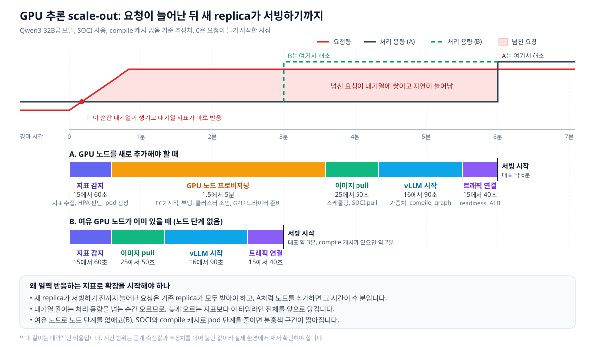

## GPU 노드 오토스케일링 ##

GPU 노드의 오토스케일링은 CPU 노드와 다릅니다. 우선 kubelet은 CPU와 메모리 사용량은 보고하지만 GPU 지표나 추론 지표는 보고하지 않습니다. 그래서 vLLM 지표나 DCGM 지표를 따로 수집해서 HPA에 넘겨 주어야 오토스케일링을 구현할 수 있습니다. 자원 할당 방식도 다릅니다. CPU와 메모리는 cgroup으로 잘게 나눠 쓸 수 있지만, GPU는 NVIDIA device plugin이 한 장 단위로 할당합니다. 따라서 replica를 늘릴 때도 GPU를 장 단위로 늘려야 합니다. 또 GPU 사용률(DCGM_FI_DEV_GPU_UTIL)은 GPU가 일하고 있는지만 보여 줄 뿐, 처리 여유가 얼마나 남았는지는 보여 주지 않습니다. 실제로 vLLM은 요청량이 크게 달라져도 GPU 사용률이 항상 100% 근처에 머물기 때문에, 이 값은 확장 기준으로 쓸 수 없습니다.

HPA가 Deployment의 replica 수를 조절하고 Karpenter가 GPU 노드를 추가하거나 회수하는 역할은 GPU 확장에서도 CPU 때와 같습니다. 다만 확장을 일으키는 트리거로는 CPU나 메모리 사용률 대신 추론 서버가 내보내는 선행 지표를 써야 합니다. 요청 대기열 길이, TTFT나 p95 같은 지연 시간, KV 캐시 사용률이 여기에 해당합니다. GPU 워크로드는 노드를 추가하고, vLLM 컨테이너 이미지를 받고, 모델을 내려받아 추론 서버가 준비되기까지 수 분이 걸립니다. 그래서 이렇게 일찍 반응하는 지표로 확장을 시작하는 것이 특히 중요합니다.

