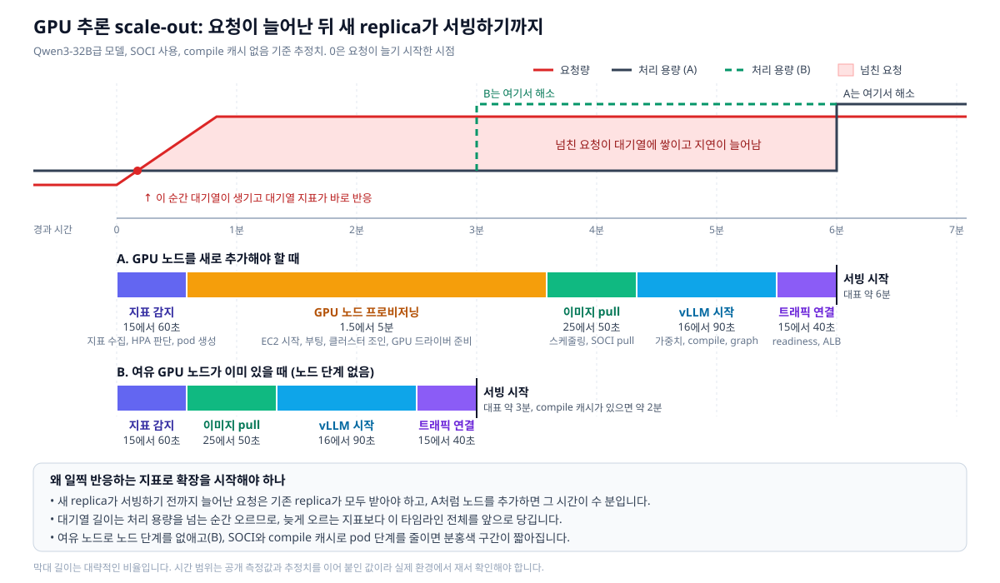

## 콜드 스타트 최적화 ##

### GPU 파드 스케줄링 소요 시간 ###

GPU 노드의 오토스케일링은 CPU 노드와 다릅니다. 우선 kubelet은 CPU와 메모리 사용량은 보고하지만 GPU 지표나 추론 지표는 보고하지 않습니다. 그래서 vLLM 지표나 DCGM 지표를 따로 수집해서 HPA에 넘겨 주어야 오토스케일링을 구현할 수 있습니다. 자원 할당 방식도 다릅니다. CPU와 메모리는 cgroup으로 잘게 나눠 쓸 수 있지만, GPU는 NVIDIA device plugin이 한 장 단위로 할당합니다. 따라서 replica를 늘릴 때도 GPU를 장 단위로 늘려야 합니다. 또 GPU 사용률(DCGM_FI_DEV_GPU_UTIL)은 GPU가 일하고 있는지만 보여 줄 뿐, 처리 여유가 얼마나 남았는지는 보여 주지 않습니다. 실제로 vLLM은 요청량이 크게 달라져도 GPU 사용률이 항상 100% 근처에 머물기 때문에, 이 값은 확장 기준으로 쓸 수 없습니다.

HPA가 Deployment의 replica 수를 조절하고 Karpenter가 GPU 노드를 추가하거나 회수하는 역할은 GPU 확장에서도 CPU 때와 같습니다. 다만 확장을 일으키는 트리거로는 CPU나 메모리 사용률 대신 추론 서버가 내보내는 선행 지표를 써야 합니다. 요청 대기열 길이, TTFT나 p95 같은 지연 시간, KV 캐시 사용률이 여기에 해당합니다. GPU 워크로드는 노드를 추가하고, vLLM 컨테이너 이미지를 받고, 모델을 내려받아 추론 서버가 준비되기까지 수 분이 걸립니다. 그래서 이렇게 일찍 반응하는 지표로 확장을 시작하는 것이 특히 중요합니다.




### 스케줄링 속도 최적화 ###

* 카펜터 노드 프로비저닝 - Amazon Linux 2023 AMI 의 경우 약 1분 소요
    * Bottlerocket AMI 적용 ?   
* 컨테이너 이미지 - SOCI parallel pull 로 변경 (시간 비교 측정 필요)
* vLLM 시작
    * 모델 Download
       * S3 Express One-Zone : ??
       * S3 run.ai streamer 적용 : 3분 -> 30초  
    * CUDA graph 캡처 & vLLM 엔진 init
       * PVC 로 구워서 마운트  ? 
* Headroom-based Proactive Scaling with KEDA   

## 최적화 하기 ##

### 1. vLLM 최적화 ###

#### 1.1 CUDA 그래프 캡처 대상 줄이기 (21s -> 3~5s 단축) ####

기본적으로 vLLM은 다양한 동시 요청 수(배치 크기: 1, 2, 4, 8 ... 최대 512개)에 대해 그래프를 모두 미리 캡처합니다. 실제 서비스 트래픽에 맞춰 최대 캡처 크기를 낮추면 캡처 시간이 대폭 줄어듭니다.
```
vllm serve <모델명> --compilation-config '{"cudagraph_capture_sizes": [1, 2, 4, 8, 16, 32]}'
```

#### 1.2 torch.compile 시간 단축 하기 (55초) ####

torch.compile은 현재 연결된 GPU 아키텍처(예: A100, L40S, H100 등)와 입력 형태에 맞춰 여러 개의 자잘한 GPU 연산(커널)을 하나로 합치고(Kernel Fusion) 최적화된 Triton/CUDA 코드를 즉석에서 빌드하는 작업으로, 작업결과는 수십 MB ~ 수백 MB (모델 크기와 무관하게 매우 작음) 이다.
GPU에서 연산을 빠르게 돌리기 위한 컴파일된 커널 코드 (.so, .cubin 등) 이다.

최초 1회 빌드된 결과물을 디스크에 저장해 두면, 이후 서버를 껐다 켜거나 새 컨테이너를 띄울 때는 컴파일을 건너뛰고 바로 로드한다.
VLLM_CACHE_ROOT와 TORCHINDUCTOR_CACHE_DIR 경로를 호스트 디스크나 EBS/EFS/S3 같은 영구 볼륨에 연결해 두면 된다.
첫 실행만 55초 걸리고, 두 번째 실행부터는 컴파일 시간이 수 초 수준으로 사라진다. 
S3 Express One Zone 같은 곳에 미리 캐시 폴더를 올려두고 컨테이너 시작 시 땡겨오는 방식도 많이 씁니다.


### 2. S3 Express One Zone 버킷 생성 ###
Express 존에 버킷을 생성하고, 모델을 다운로드 받는다. 

### 3. 카펜터 노드풀 생성 ### 
Bottlerocket AMI 와 SOCI Parallel Pull 이 가능한 GPU 노드풀을 생성한다.

### 4. 서비스 어카운트 생성 ###

### 5. vLLM 파드 스케줄링 ###
