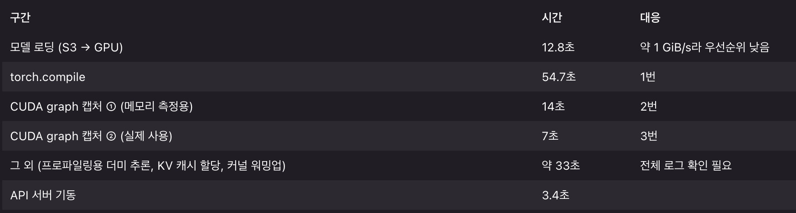

### vLLM 로그 ###
```
2026-11-23T15:41:29.952313791Z (EngineCore pid=225) INFO 11-23 15:41:29 [model_runner.py:428] Model loading took 12.75 GiB memory and 12.762926 seconds
2026-11-23T15:43:08.549761612Z (EngineCore pid=225) INFO 11-23 15:43:08 [model_runner.py:1163] Graph capturing finished in 14 secs, took 0.52 GiB
2026-11-23T15:43:17.680269763Z (EngineCore pid=225) INFO 11-23 15:43:17 [model_runner.py:1163] Graph capturing finished in 7 secs, took 0.30 GiB
2026-11-23T15:43:18.971310602Z (EngineCore pid=225) INFO 11-23 15:43:18 [core.py:405] init engine (profile, create kv cache, warmup model) took 108.99 s (compilation: 54.72 s)
2026-11-23T15:43:22.393764308Z INFO:     Application startup complete.
```
로그에 보이는 구간만 약 2분 5초이고, 가장 오래 걸리는 건 torch.compile(55초)과 첫 번째 CUDA graph 캡처(14초) 이다. 둘 다 두 번째 기동부터 건너뛸 수 있다.
vLLM은 torch.compile 결과를 /home/vllm/.cache/vllm/torch_compile_cache에, Triton 커널을 /home/vllm/.cache/triton에 저장해요. 다음 기동 때 캐시가 있으면 컴파일하지 않고 불러오기 때문에 `55`초가 `몇 초`로 줄어든다.



### vLLM 기동 최적화 ###

<ins>**.cache 디렉토리의 내용을 S3 에 저장한 후, 신규 파드가 기동될때 init container 에서 emptyDir 로 내려 받도록 하여 vLLM 기동 시간은 193초 에서 2분 정도로 줄였다.**</ins>

#### 1. 파드가 바뀌어도 캐시 디렉터리 유지하기 ####

vLLM은 `torch.compile 결과`를 /home/vllm/.cache/vllm/torch_compile_cache에, `Triton 커널`을 /home/vllm/.cache/triton에 저장해요. 다음 기동 때 캐시가 맞으면 컴파일하지 않고 불러오기 때문에 55초가 몇 초로 줄어둔다. 캐시를 쓰면 Directly load ... 로그가 찍히고, 마지막 줄의 compilation: 값이 작아진다.

emptyDir는 같은 파드 안에서 컨테이너가 재시작될 때만 남는다. 새 파드도 캐시를 쓰게 하려면 `S3 에 저장후 init container 에서 emptyDir로 내려받는다`.
캐시 키에는 vLLM 버전, 주요 서빙 인자(max-model-len 등), GPU 종류가 들어간다. 

#### 2. 메모리 측정 결과 재사용하기: VLLM_ENABLE_STARTUP_PLAN=1 ####

첫 번째 캡처는 KV 캐시 크기를 정하기 전에 CUDA graph가 쓸 메모리를 재려고 한 번 캡처하고 버리는 과정이다. 
VLLM_ENABLE_STARTUP_PLAN=1(기본값은 꺼짐)을 켜면, 처음 측정한 KV 캐시 크기를 /home/vllm/.cache/vllm/startup_plan/에 저장한다. 다음 기동부터는 설정과 GPU가 같으면 메모리 측정과 이 캡처를 건너뛴다. 적용되면 Applying persisted startup plan ... 로그가 찍혀요.

#### 3. CUDA graph 캡처 크기 줄이기 ####

CUDA graph는 배치 크기마다 따로 캡처한다. 최대 크기의 기본값은 max_num_seqs의 2배이고 상한은 512 이다. 
--max-cudagraph-capture-size=128로 낮추면 1~128 사이의 19개 크기만 캡처한다. 2번을 안 쓰면 첫 번째 캡처 시간도 같이 줄어든다. 대신 배치가 이 값보다 크면 CUDA graph 없이 실행돼서 느려진다. 

```
          args:
            # ...기존 인자...
            - --max-cudagraph-capture-size=128
          env:
            # ...기존 env...
            - name: VLLM_ENABLE_STARTUP_PLAN
              value: "1"
          volumeMounts:
            - name: vllm-cache
              mountPath: /home/vllm/.cache

```
1번과 2번을 적용하면 두 번째 기동부터 컴파일 약 50초와 첫 번째 캡처 14초가 감소한다. 그래서 `73초 정도 빨라져서 120초 기동시간이 소요된다. (기존 193초)` 

> [!NOTE]
>
> torch.compile은 PyTorch 모델 코드를 GPU에서 더 빨리 도는 커널로 바꿔 주는 컴파일러다. 기본 PyTorch(eager 모드)는 연산을 하나씩 GPU에 보내고, 중간 결과를 매번 GPU 메모리에 썼다가 다시 읽는다. torch.compile은 첫 호출 때 전체 연산을 보고 최적화된 버전을 만든다. Dynamo가 연산 그래프를 뽑으면 Inductor가 그 그래프를 최적화해서 Triton 커널을 만들고, Triton이 그 커널을 GPU 기계어로 컴파일한다. 연달아 나오는 작은 연산을 커널 하나로 합치기 때문에 메모리 왕복과 커널 실행 횟수가 줄어서 빨라진다. 행렬 곱과 attention은 원래 쓰던 전용 커널을 그대로 쓴다.
> vLLM은 기동 중에 더미 입력으로 모델을 한 번 컴파일하고, 그 결과를 모든 배치 크기에 쓴다. 로그의 compilation: 54.72 s가 이 컴파일 시간이다. 컴파일 결과는 캐시에 저장돼서 다음 기동 때 다시 쓸 수 있다. 로그에 같이 나오는 CUDA graph는 하는 일이 다르다. torch.compile은 커널 수를 줄이고 커널 자체를 빠르게 만든다. CUDA graph는 커널 실행 순서를 녹화했다가 재생해서 CPU 오버헤드를 줄인다. --enforce-eager를 주면 둘 다 꺼진다.
