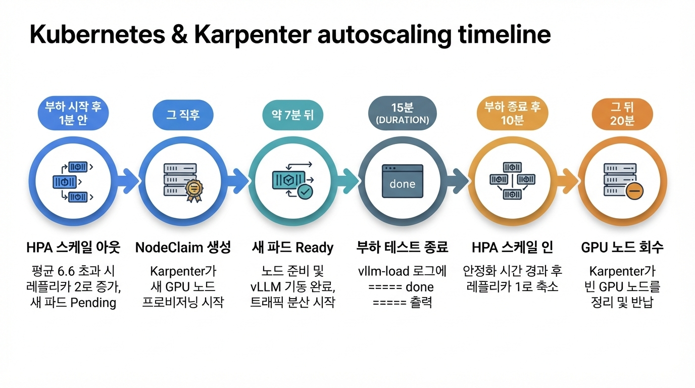

### 부하 생성하기 ###

vllm bench serve는 연결을 재사용하므로, 레플리카가 늘어도 이미 연결된 기존 파드로만 요청을 보냅니다. 그래서 여기서는 요청마다 새 연결을 여는 curl로 부하를 겁니다.

```
kubectl apply -f - <<'EOF'
apiVersion: v1
kind: Pod
metadata:
  name: vllm-load
  namespace: llm-serving
spec:
  restartPolicy: Never
  containers:
    - name: load
      image: curlimages/curl:8.23.0
      command: ["sh", "-c"]
      args:
        - |
          END=$(( $(date +%s) + DURATION ))
          for i in $(seq "$CONCURRENCY"); do
            while [ "$(date +%s)" -lt "$END" ]; do
              curl -sSf -o /dev/null --max-time 120 "$URL" \
                -H 'Content-Type: application/json' \
                -d "{\"model\":\"gemma-4-12b\",\"max_tokens\":256,\"ignore_eos\":true,\"messages\":[{\"role\":\"user\",\"content\":\"[$i-$RANDOM] Explain Kubernetes autoscaling in detail.\"}]}" \
                || sleep 1
            done &
          done
          wait
          echo "===== done ====="
      env:
        - name: URL
          value: http://gemma4-12b-vllm.llm-serving.svc.cluster.local:8000/v1/chat/completions
        - name: CONCURRENCY          # 동시에 유지할 요청 수 (12 → 레플리카 2, 24 → 4)
          value: "12"
        - name: DURATION             # 부하를 거는 시간 (초)
          value: "900"
      resources:
        requests:
          cpu: 200m
          memory: 64Mi
        limits:
          memory: 128Mi
EOF
```
이 파드는 요청 12개를 계속 동시에 보냅니다. 그래서 전체 동시 요청 수가 12 근처에 머물고 목표 레플리카는 ceil(12 ÷ 6) = 2가 됩니다. CONCURRENCY를 24로 바꾸면 4까지 늘어납니다.

### 오브젝트 확인하기 ###

```
# 터미널 1: HPA 지표와 레플리카
kubectl get hpa keda-hpa-gemma4-12b-vllm -n llm-serving -w

# 터미널 2: vLLM 파드
kubectl get pods -n llm-serving -l app.kubernetes.io/name=gemma4-12b-vllm -w

# 터미널 3: GPU 노드
kubectl get nodeclaims -w
```




### Grafana로 보기 ###

```
kubectl get secret grafana-admin -n monitoring -o jsonpath='{.data.admin-password}' | base64 -d; echo
kubectl -n monitoring port-forward svc/kube-prometheus-stack-grafana 3000:80
```
브라우저에서 3000 포트로 접속해 admin 계정으로 로그인합니다. 원격 VS Code 서버에서 실행했다면 VS Code의 포트 포워딩으로 엽니다. Explore에서 아래 쿼리로 패널을 만듭니다.


| 패널 | PromQL |
| :--- | :--- |
| 파드별 처리 중 요청 | `sum by (pod) (vllm:num_requests_running{namespace="llm-serving"})` |
| 대기 요청 | `sum(vllm:num_requests_waiting{namespace="llm-serving"})` |
| 파드별 KV 캐시 사용률 | `vllm:kv_cache_usage_perc{namespace="llm-serving"}` |
| HPA 목표 레플리카 | `kube_horizontalpodautoscaler_status_desired_replicas{namespace="llm-serving"}` |
| HPA 현재 레플리카 | `kube_horizontalpodautoscaler_status_current_replicas{namespace="llm-serving"}` |
| TTFT p99 | `histogram_quantile(0.99, sum by (le) (rate(vllm:time_to_first_token_seconds_bucket{namespace="llm-serving"}[1m])))` |


### 운영할 때 알아 둘 점 ###

* threshold 조정: 실제 트래픽의 입력과 출력 길이로 4장 측정을 다시 합니다. 그다음 SLO를 지키는 파드당 동시성의 75% 정도로 잡습니다. 콜드 스타트를 줄이면(C6) 목표를 한계에 더 가깝게 올릴 수 있습니다.

* 예측 가능한 피크: 반응형 스케일링은 새 파드가 준비될 때까지 7분 정도 늦습니다. 출근 시간처럼 미리 아는 피크에는 같은 ScaledObject에 cron 트리거를 추가해 미리 늘립니다. HPA는 트리거 중 가장 큰 값을 쓰므로 그 시간대에는 최소 2개가 유지됩니다.

```
    - type: cron
      metadata:
        timezone: Asia/Seoul
        start: "0 9 * * 1-5"         # 평일 09:00부터
        end: "0 19 * * 1-5"          # 19:00까지
        desiredReplicas: "2"
```
* 0까지 줄이기: minReplicaCount: 0이면 파드가 없을 때 vLLM 지표도 없어서 다시 늘릴 신호가 없습니다. 첫 요청도 약 7분을 기다리게 됩니다. 쓰려면 앞단(LiteLLM, 큐 등)이 들어온 요청을 세는 지표를 트리거로 써야 합니다. 대화형 서비스보다는 배치 작업에 맞습니다.
* 수동 조작: HPA가 켜진 뒤에는 매니페스트에 replicas를 다시 넣지 않습니다. 자동 조절을 잠시 멈추려면 ScaledObject에 autoscaling.keda.sh/paused: "true" 애노테이션을 붙입니다.
* Prometheus와 Grafana는 ClusterIP로만 두고 port-forward(127.0.0.1)로 접속합니다. Prometheus API에는 인증이 없으므로 LoadBalancer나 Ingress로 열지 않습니다.

### 리소스 삭제 ###
```
kubectl delete pod vllm-load -n llm-serving --ignore-not-found

# ScaledObject를 먼저 지운다 (KEDA를 먼저 지우면 finalizer 때문에 삭제가 멈출 수 있음)
# HPA도 함께 지워지고 레플리카는 그때 개수로 남는다
kubectl delete scaledobject gemma4-12b-vllm -n llm-serving
kubectl scale deployment gemma4-12b-vllm -n llm-serving --replicas=1
kubectl delete servicemonitor gemma4-12b-vllm -n llm-serving

helm uninstall keda -n keda
helm uninstall kube-prometheus-stack -n monitoring
kubectl delete namespace keda monitoring

# 남은 CRD 삭제 (클러스터의 다른 곳에서 쓰지 않을 때만)
kubectl get crd -o name | grep -E 'monitoring.coreos.com|keda.sh' | xargs -r kubectl delete
```

## 레퍼런스 ##

* [KEDA 이벤트 기반 오토스케일링 도입](https://gnobaaaaar.tistory.com/150) 
