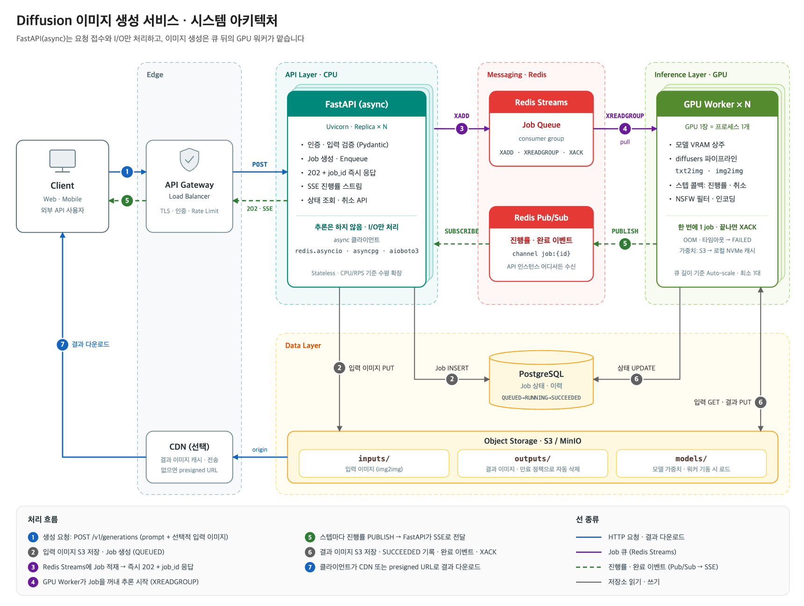

생성 요청(POST /v1/generations)은 API 서버가 Job을 DB와 큐에 넣고 202 Accepted와 job_id를 돌려주면 끝난다. API 서버는 그 요청을 붙잡고 GPU 작업이 끝나기를 기다리지 않는다. HTTP keep-alive 때문에 TCP 연결은 재사용을 위해 잠시 열려 있을 수 있지만, 그 요청과 응답은 이미 끝난 상태이다.

결과는 클라이언트가 job_id로 새 요청을 보내서 받아간다. 방법은 세 가지 중에서 구현할 수 있다.


| 방식 | 동작 | 적합한 경우 |
| :--- | :--- | :--- |
| **Polling** | `GET /v1/generations/{id}`를 1~2초마다 호출 | 가장 단순해서 처음 만들 때(MVP) 적합 |
| **SSE** | `GET /v1/generations/{id}/events` 연결을 열어 두면 서버가 진행률과 완료를 push | 웹 화면에서 진행률 표시 |
| **Webhook** | 요청할 때 `callback_url`을 받아 두고, 완료되면 서버가 그 URL을 호출 | 서버 간 연동 |


### SSE 흐름 ###
```
POST /v1/generations              → 202 {"job_id": "abc"}       여기서 요청 종료
GET  /v1/generations/abc/events   (별도 연결, 열린 채 유지)
     ← event: progress {"step": 10, "total": 30}
     ← event: progress {"step": 20, "total": 30}
     ← event: completed {"result_url": "https://..."}           서버가 스트림 종료
GET  https://.../outputs/abc/0.webp                             이미지 다운로드
```

## MVP ##
### 1. API 서버 ###
```
DiT/
├── app.py
└── static/
    ├── index.html
    └── app.js
```

* https://github.com/gnosia93/infer-on-eks/blob/main/src/DiT/app.py
* https://github.com/gnosia93/infer-on-eks/blob/main/src/DiT/static/index.html
* https://github.com/gnosia93/infer-on-eks/blob/main/src/DiT/static/app.js

### 2. DB ###
```
CREATE TABLE jobs (
    id          UUID PRIMARY KEY,
    user_id     TEXT NOT NULL,
    status      TEXT NOT NULL,   -- QUEUED, RUNNING, SUCCEEDED, FAILED, CANCELED
    mode        TEXT NOT NULL,   -- txt2img, img2img
    params      JSONB NOT NULL,
    input_key   TEXT,
    result_key  TEXT,
    error       TEXT,
    created_at  TIMESTAMPTZ NOT NULL DEFAULT now()
);
```

### 3. 실행 ###
```
pip install fastapi uvicorn python-multipart pillow "redis>=5.0.1" asyncpg aioboto3
# DATABASE_URL, REDIS_URL, IMAGE_BUCKET 환경변수 설정 후
AUTH_TEST_BYPASS=1 uvicorn app:app --host 127.0.0.1 --port 8000

curl -i -X POST http://127.0.0.1:8000/v1/generations -F prompt="a cat in space"
# → 202 {"job_id": "...", "status": "QUEUED", ...}
```
