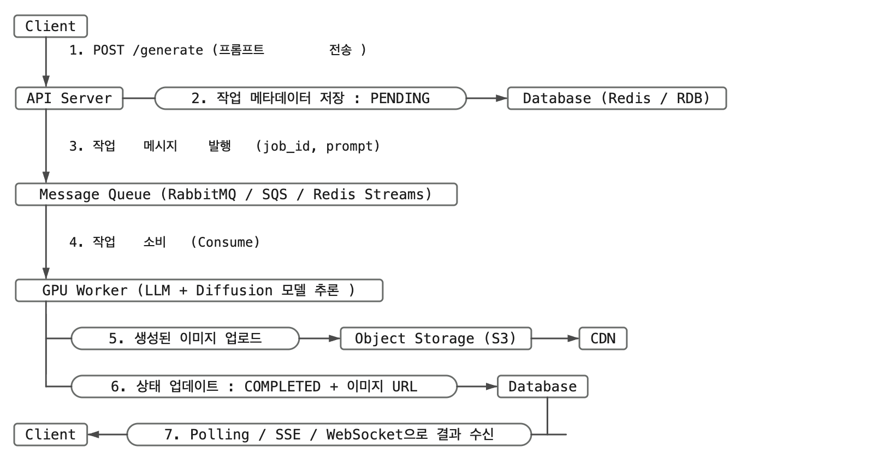
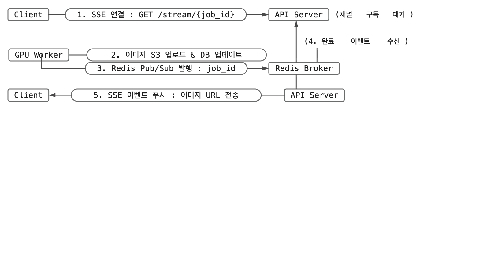

### API 서버 ###
```
import asyncio
import json
from fastapi import FastAPI, Request
from fastapi.responses import StreamingResponse
import redis.asyncio as redis

app = FastAPI()
redis_client = redis.from_url("redis://localhost:6379")

@app.get("/stream/{job_id}")
async def stream_image_status(job_id: str, request: Request):
    async def event_generator():
        # 1. Redis에서 해당 job_id 채널 구독
        pubsub = redis_client.pubsub()
        await pubsub.subscribe(f"job:{job_id}")

        try:
            while True:
                # 클라이언트가 브라우저를 닫았는지 확인
                if await request.is_disconnected():
                    break

                # 2. 워커가 보낸 메시지가 있는지 대기 (15초 타임아웃으로 연결 유지용 핑 전송)
                message = await pubsub.get_message(ignore_subscribe_messages=True, timeout=15.0)
                
                if message:
                    # 3. 완료 신호 수신 시 클라이언트로 데이터 전송 후 종료
                    data = message["data"].decode("utf-8")
                    yield f"data: {data}\n\n"
                    break
                else:
                    # 타임아웃 방지용 빈 신호 (Keep-alive)
                    yield ": ping\n\n"
                    
        finally:
            # 4. 연결 종료 시 Redis 구독 해제 (메모리 누수 방지)
            await pubsub.unsubscribe(f"job:{job_id}")

    # 일반 JSON 대신 text/event-stream 형태로 응답 반환
    return StreamingResponse(event_generator(), media_type="text/event-stream")
```
