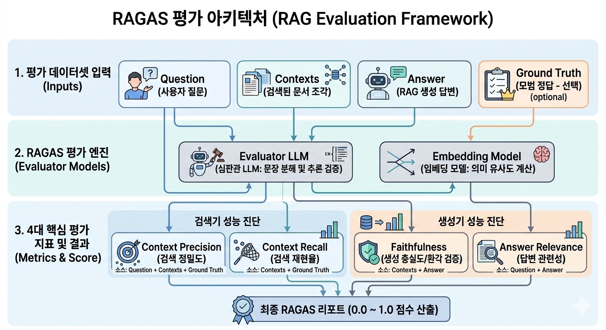

RAGAS는 모범 정답(Ground Truth) 구축에 많은 인력이 들고 채점 주체인 심판관 LLM의 환각·편향 및 API 비용 한계가 뚜렷하므로, 실무에서는 소수의 핵심 정답 셋으로 배포 전 최소한의 회귀 테스트(regression test) 만 수행하고 배포 후 실제 사용자 피드백(좋아요/싫어요 로그)을 수집해 개선하는 방식이 가장 현실적인 대안이다.
