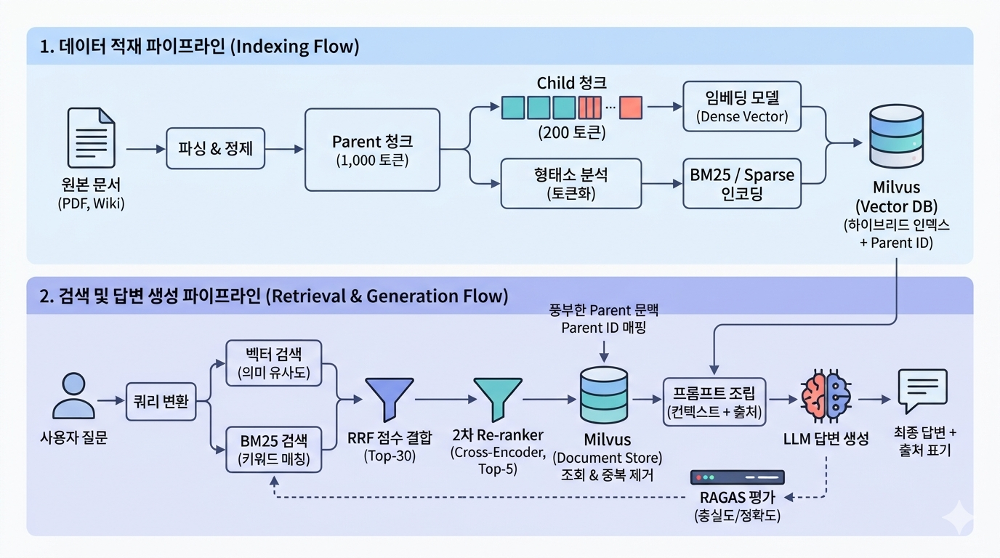

## RAG 아키텍처 ##

* RRF(Reciprocal Rank Fusion) - 키워드 검색과 벡터 검색 결과를 합칠때 '순위(Rank)'만을 이용해 최종 순위를 다시 계산.

#### 1. Parent / Child 청킹을 나누는 이유

긴 문서를 통째로 벡터화할 때 발생하는 의미 희석(Semantic Dilution, 벡터 뭉개짐)을 막기 위해 잘게 쪼갠 Child 청크로 검색 정확도를 높이고, 답변 생성 시에는 원본 문맥이 담긴 Parent 청크를 통째로 LLM에 전달하여 검색 정밀도와 문맥 풍부함을 동시에 확보하기 위함입니다.

#### 2. 쿼리 변환 (Query Transformation)

사용자의 모호하거나 구어체로 된 날것의 질문을 그대로 검색하지 않고, 검색 엔진이 문서를 가장 잘 찾아낼 수 있도록 LLM을 활용해 핵심 키워드 중심으로 재작성하거나 여러 하위 질문으로 확장·분해하는 전처리 과정입니다.

#### 3. BM25와 Sparse 인코딩

• BM25: 형태소 분석기로 쪼갠 단어들의 빈도(TF), 희귀도(IDF), 문서 길이를 종합 계산하여 질문과 문서 간의 정확한 키워드 관련성 점수를 매기는 통계 기반 순위 산정 알고리즘입니다.
• Sparse 인코딩: 문장에 등장한 핵심 단어의 사전 고유 번호(Index)와 BM25 등으로 계산된 가중치(Value)만을 추출해, 벡터 DB가 고속으로 키워드 연산을 수행할 수 있도록 압축된 희소 벡터(Sparse Vector) 형태로 변환하는 작업입니다.

#### 4. 메타데이터 (Metadata) 설계 및 필터링

문서 본문 외에 작성일, 부서, 문서 유형, 보안 등급, 페이지 번호 등 부가 속성 정보를 함께 저장해 두어, 벡터 검색 전후에 조건 필터링(Pre/Post-filtering)을 적용함으로써 검색 범위를 좁혀 정확도와 보안성을 동시에 높이는 핵심 요소입니다.

RAGAS는 모범 정답(Ground Truth) 구축에 많은 인력이 들고 채점 주체인 심판관 LLM의 환각·편향 및 API 비용 한계가 뚜렷하므로, 실무에서는 소수의 핵심 정답 셋으로 배포 전 최소한의 회귀 테스트(regression test) 만 수행하고 배포 후 실제 사용자 피드백(좋아요/싫어요 로그)을 수집해 개선하는 방식이 가장 현실적인 대안이다.
