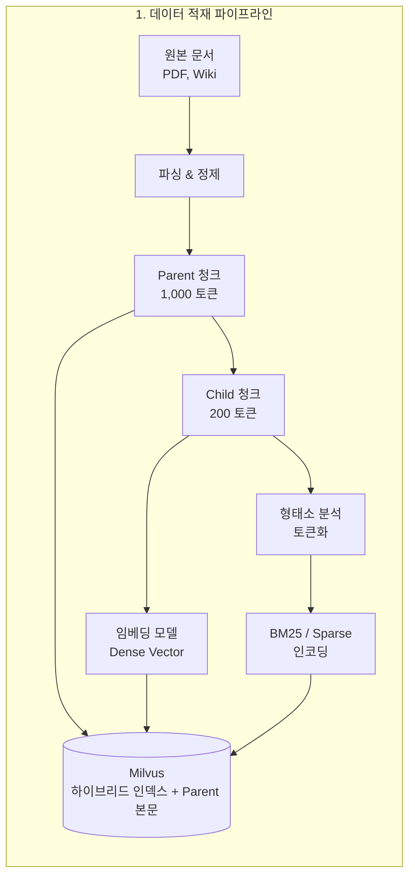
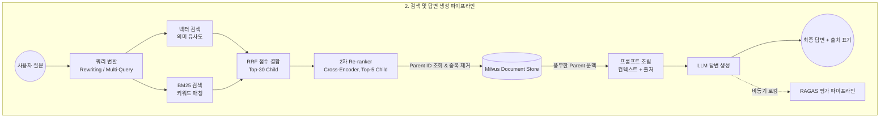
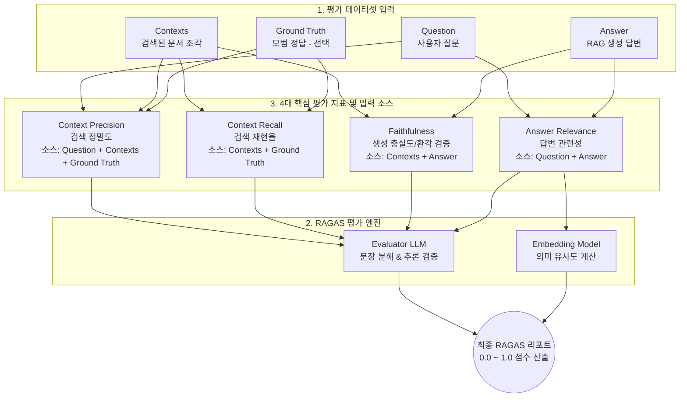

# RAG (검색 증강 생성) 시스템 구축 핵심 고려 사항

RAG 시스템을 성공적으로 구축하기 위해서는 **데이터 전처리부터 검색 품질 최적화, 답변 생성 및 정량적 평가까지 파이프라인 전반의 정교한 설계**가 필수적입니다.

---

## 1. 데이터 수집 및 전처리 (Indexing)
* **문서 파싱(Parsing) 품질:** PDF, 표, 이미지 등 비정형 데이터에서 텍스트와 레이아웃 구조가 깨지지 않게 추출해야 합니다. 표나 차트가 많다면 레이아웃 인식 파서나 OCR(광학 문자 인식) 도입이 필수적입니다.
* **청킹(Chunking) 전략:** 문서를 너무 잘게 자르면 문맥이 끊기고, 너무 크게 자르면 불필요한 노이즈가 섞여 검색 정확도가 떨어집니다. 문서 성격에 맞춰 적절한 토큰 크기와 겹침(Overlap) 비율을 설정하거나 의미 단위(Semantic Chunking)로 분할해야 합니다.
* **메타데이터(Metadata) 설계:** 작성일, 문서 카테고리, 부서, 페이지 번호 등을 함께 저장해 두면 검색 시 조건 필터링(Scalar Filtering)을 통해 정확도와 보안을 크게 높일 수 있습니다.

## 2. 임베딩 및 검색 (Retrieval)
* **임베딩 모델 선택:** 서비스 주 언어(특히 한국어)의 뉘앙스와 도메인 전문 용어를 잘 이해하는 모델을 선택해야 합니다.
* **하이브리드 검색(Hybrid Search):** 의미 기반의 벡터 검색(Dense)만으로는 고유명사나 에러 코드 같은 정확한 키워드 매칭에 약할 수 있으므로, 키워드 검색(BM25 등)을 결합해야 합니다.
* **재순위화(Re-ranking):** 1차로 넓게 검색된 문서 조각(Top-K)들을 Cross-Encoder 같은 정밀 모델로 다시 점수를 매겨, 질문과 가장 관련성 높은 상위 문서만 LLM에 전달해야 답변 품질과 비용 효율을 동시에 잡을 수 있습니다.
* **쿼리 변환(Query Transformation):** 사용자의 모호하거나 긴 질문을 검색하기 좋은 형태로 재작성(Query Rewriting)하거나 여러 하위 질문으로 쪼개어 검색하는 기법을 적용합니다.

## 3. 답변 생성 및 프롬프트 (Generation)
* **환각(Hallucination) 통제:** 프롬프트에 *"제공된 문서 내용만을 근거로 답변하고, 정보가 없으면 모른다고 답하라"*는 명확한 제약 조건을 부여해야 합니다.
* **출처(Citation) 표기:** 사용자가 답변의 신뢰성을 검증할 수 있도록 참조한 원본 문서명이나 페이지 번호를 함께 출력하도록 설계합니다.
* **컨텍스트 한계 관리:** 검색된 문서를 프롬프트에 너무 많이 넣으면 모델이 중간 내용을 놓치는 현상(Lost in the Middle)이 발생하고 토큰 비용과 지연 시간(Latency)이 증가합니다.

## 4. 운영, 보안 및 평가 (Ops & Evaluation)
* **데이터 동기화 파이프라인:** 원본 문서가 수정·삭제·추가될 때 벡터 DB에도 실시간 또는 주기적으로 반영되도록 자동화해야 합니다.
* **권한 제어(Access Control):** 사내 문서 기반 시스템이라면 사용자 직급이나 부서 권한에 따라 접근 가능한 문서만 검색되도록 보안 필터링을 적용해야 합니다.
* **정량적 평가 체계:** RAGAS 같은 평가 프레임워크를 활용해 검색 정확도와 생성 충실도를 분리하여 측정하고 지속적으로 개선해야 합니다.

---

## [심화 1] 청킹과 벡터 뭉개짐 현상 & 부모-자식 청킹 (Parent-Child Chunking)

### 1. 벡터 뭉개짐 (Semantic Dilution) 현상
1,000토큰 이상의 긴 텍스트를 단 하나의 고정 길이 벡터(예: 1024~1536차원)로 압축하면 여러 주제가 혼합되어 평균적인 좌표로 수렴하면서 세부 키워드의 의미가 희석됩니다.

### 2. 부모-자식 청킹 (Parent-Child / Small-to-Big) 전략
* **아들 청크 (Child, 예: 200토큰):** 검색 전용으로 사용합니다. 덩치가 작아 벡터가 뭉개지지 않으므로 사용자의 질문과 핀포인트로 일치하는 구절을 정확히 찾아냅니다.
* **아빠 청크 (Parent, 예: 1,000토큰):** 생성 전용으로 사용합니다. `parent_id`로 연결되어 있다가 아들이 검색되면 원본 본문을 통째로 LLM에 넘겨주어 앞뒤 맥락이 잘리지 않은 답변을 생성하게 합니다.

### 3. 실무 실행 순서 및 주의점
1. **Child 기준 Re-ranking 먼저 수행:** Cross-Encoder 기반 Re-ranker는 보통 최대 입력 길이가 512토큰으로 제한되므로, 작은 Child 단위로 먼저 정밀 채점하여 상위 Top-K(예: Top-5~10)를 선별합니다.
2. **Parent ID 기준 중복 제거 (Deduplication):** 선별된 상위 Child들이 동일한 부모 문서에서 나왔을 경우, LLM 프롬프트에 똑같은 부모 본문이 중복 투입되지 않도록 `parent_id` 기준으로 중복을 제거한 뒤 고유한 부모 본문만 조회합니다.

---

## [심화 2] 쿼리 변환 (Query Transformation) 전략

사용자의 날것의 질문을 검색 엔진이 문서를 가장 잘 찾아낼 수 있는 형태로 LLM을 통해 재구성하는 전처리 단계입니다.

1. **쿼리 재작성 (Query Rewriting):** 불필요한 구어체나 모호한 지시대명사를 제거하고 핵심 키워드 중심의 명확한 검색어로 변환합니다.
2. **멀티 쿼리 생성 (Multi-Query):** 하나의 질문을 다양한 관점과 표현을 가진 3~5개의 유사 질문으로 확장해 병렬 검색 후 결과를 통합합니다.
3. **질문 분해 (Sub-Query Decomposition):** 여러 조건이 섞인 복합 질문을 검색하기 쉬운 단일 질문 여러 개로 쪼개어 각각 검색합니다.
4. **가상 답변 생성 (HyDE):** 질문 자체로 검색하지 않고 LLM이 '정답이 적혀 있을 법한 가상의 문서'를 먼저 생성한 뒤, 그 가상 문서의 임베딩 벡터로 DB를 검색하여 문체 차이를 극복합니다.
* **운영 팁 (라우팅):** 모든 질문에 쿼리 변환을 적용하면 지연 시간(Latency)과 비용이 증가하므로, 단순 키워드 질문은 건너뛰고 복잡하거나 모호한 질문일 때만 작동하도록 라우팅(Routing)하는 것이 좋습니다.

---

## [심화 3] 하이브리드 검색 (Hybrid Search) & BM25 / Sparse 인코딩

### 1. 하이브리드 검색 구현 프로세스
1. **데이터 이중 색인:** 동일한 Child 청크를 의미 기반의 **Dense Vector**와 키워드 가중치 기반의 **Sparse Vector(또는 역색인)** 두 가지 형태로 모두 저장합니다.
2. **병렬 검색:** 사용자 질문이 들어오면 벡터 검색과 키워드 검색에서 각각 상위 후보 문서를 추출합니다.
3. **점수 결합 (RRF, Reciprocal Rank Fusion):** 서로 다른 점수 체계를 통합하기 위해 각 검색 결과의 **순위(Rank)**만을 이용해 점수를 재계산합니다.
   * $\text{RRF Score} = \frac{1}{k + \text{Rank}_{\text{keyword}}} + \frac{1}{k + \text{Rank}_{\text{vector}}}$ (보통 $k=60$)

### 2. 형태소 분석과 BM25 / Sparse 인코딩의 정확한 구분
* **형태소 분석기 (Tokenizer, 예: Nori, Kiwi, Mecab):** 문장을 의미 있는 단어(토큰) 단위로 쪼개주는 도구입니다.
* **BM25 (Ranking Algorithm):** 쪼개진 단어들의 빈도(TF), 전체 문서 내 희귀도(IDF), 문서 길이 정규화를 계산해 관련성 점수를 매기는 통계적 순위 산정 공식입니다.
* **BM25 / Sparse 인코딩:** 형태소 분석으로 추출된 토큰에 BM25 가중치를 계산한 뒤, 벡터 DB가 저장하고 내적(Inner Product) 연산으로 초고속 검색할 수 있도록 단어 사전 ID(`indices`)와 가중치(`values`) 쌍의 희소 벡터 형태로 변환하는 과정입니다.

### 3. 단일 DB 통합 구조 (예: Milvus)
별도의 Document Store 없이 **Milvus** 하나로 Vector DB와 Document Store 역할을 통합할 수 있습니다.
* **컬렉션 분리 방식:** `child_chunks`(Dense + Sparse 벡터, `parent_id`)와 `parent_docs`(`parent_id`, `parent_text`) 두 컬렉션으로 나누어 데이터 중복을 방지합니다.
* **단일 컬렉션 통합 방식:** Child 레코드 내부에 `parent_text` 필드(`VARCHAR`, 최대 65,535바이트)를 함께 저장하여 한 번의 검색 쿼리로 원본 문맥까지 즉시 반환합니다.

---

## [심화 4] 실무형 고급 RAG 파이프라인 아키텍처

---

## [심화 5] RAGAS (RAG Assessment) 평가 아키텍처 및 지표

RAGAS는 RAG 파이프라인의 결과물(`Question`, `Contexts`, `Answer`, 선택적 `Ground Truth`)을 입력받아 **심판관 LLM(Evaluator LLM)**과 **임베딩 모델(Embedding Model)**을 통해 검색기와 생성기 성능을 분리하여 정량 평가(0.0 ~ 1.0)하는 프레임워크입니다.

### 1. RAGAS 평가 아키텍처 흐름

### 2. 4대 핵심 평가 지표 및 입력 소스 정리

| 평가 영역 | 지표명 | 측정 목적 | 필요 입력 소스 (Inputs) |
| :--- | :--- | :--- | :--- |
| **검색기 (Retriever)** | **Context Precision** (검색 정밀도) | 검색된 문서 중 정답과 관련된 문서가 얼마나 상위에 정확히 배치되었는가 | `Question` + `Contexts` + `Ground Truth` |
| **검색기 (Retriever)** | **Context Recall** (검색 재현율) | 모범 정답을 구성하는 데 필요한 핵심 정보가 검색된 문서에 빠짐없이 포함되었는가 | `Contexts` + `Ground Truth` |
| **생성기 (Generator)** | **Faithfulness** (생성 충실도) | 생성된 답변의 모든 문장이 검색된 문서 내용에만 근거하고 있는가 (환각 검증) | `Contexts` + `Answer` |
| **생성기 (Generator)** | **Answer Relevance** (답변 관련성) | 생성된 답변이 불필요한 사족 없이 사용자의 원래 질문 의도에 부합하는가 | `Question` + `Answer` |

* **실무 활용 팁:** 정답지(`Ground Truth`) 구축 비용이 부담될 때는, 정답지가 필요 없는 **Faithfulness**와 **Answer Relevance** 두 지표를 먼저 운영 로그에 연결해 실시간 모니터링을 시작하고, 이후 핵심 질문 50~100개에 대해서만 정답지를 구축해 검색기 지표를 주기적으로 점검하는 것이 효율적입니다.
