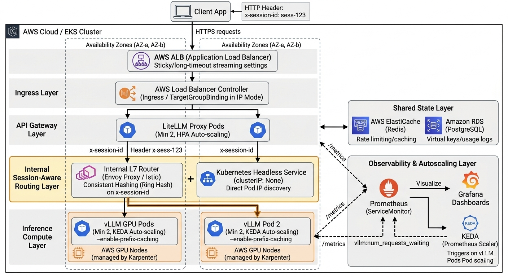

# infer-on-eks

### 트래픽 흐름 ###
* AWS ALB → LiteLLM Service (Ingress/TargetGroup)를 바라봄
* LiteLLM Proxy 파드 → Envoy Router Service를 바라봄 (api_base 설정)
* Envoy Router 파드 → vLLM Headless Service를 통해 각 vLLM 파드들의 실제 IP를 바라봄
(Envoy가 x-session-id 헤더를 해싱해서 특정 vLLM 파드 IP로 직접 꽂아줌)

 만약 EKS 클러스터에 Istio가 설치되어 있다면 별도의 Envoy 파드를 띄우지 않으므로, LiteLLM은 그냥 http://vllm-headless-service:8000/v1을 바라보고 Istio의 사이드카 프록시가 중간에서 가로채어 라우팅

### _Basic_ ###

* [C1. VPC 생성하기](https://github.com/gnosia93/infer-on-eks/blob/main/lesson/1-create-vpc.md)

* [C2. EKS 클러스터 생성하기](https://github.com/gnosia93/infer-on-eks/blob/main/lesson/2-create-eks.md)

* [C3. Karpenter 노드풀 생성](https://github.com/gnosia93/infer-on-eks/blob/main/lesson/3-karpenter-nodepool.md)
  * [Graviton 노드풀 생성](https://github.com/gnosia93/infer-on-eks/blob/main/lesson/3-karpenter-graviton-nodepool.md)
  * [GPU 노드풀 생성](https://github.com/gnosia93/infer-on-eks/blob/main/lesson/3-karpenter-gpu-nodepool.md)

* C4. 디바이스 플로그인 설치
  * [EFA 플러그인 설치](https://github.com/gnosia93/infer-on-eks/blob/main/lesson/4-efa-plugin.md)
  * [NVIDIA 디바이스 플러그인 설치](https://github.com/gnosia93/infer-on-eks/blob/main/lesson/4-gpu-plugin.md)
  * [쿠버네티스 네트워크 최적화](https://github.com/gnosia93/infer-on-eks/blob/main/lesson/4-network-optimization.md) 

* [C5. Qwen3-32B 모델 배포](https://github.com/gnosia93/infer-on-eks/blob/main/lesson/5-model-deploy.md)

* [C6. Auto Scaling](https://github.com/gnosia93/infer-on-eks/blob/main/lesson/6-auto-scaling.md)

* [배치 인퍼런스]

* C7. LLM 성능 평가 및 보안
   * [LLM 성능 평가(LLM 품질 평가 - Model/Prompt Evaluation)](https://github.com/gnosia93/infer-on-eks/blob/main/lesson/3-promptfoo-perf.md) 
   * llm 보안 취약점 스캔
   * [LLM 부하/서빙 성능 (Serving Performance)](https://github.com/gnosia93/infer-on-eks/blob/main/lesson/7-llm-serving-performance.md)
    
* C8. Observability
   * [GPU 모니터링](https://github.com/gnosia93/infer-on-eks/blob/main/lesson/8-gpu-observability.md)
   * [EFA 모니터링](https://github.com/gnosia93/infer-on-eks/blob/main/lesson/8.efa-observability.md)

### _Advanced_ ###

* [C9. lustre 설정](https://github.com/gnosia93/infer-on-eks/blob/main/lesson/5-create-lustre.md)
      
* [C10. LeaderWorkerSet (LWS) & Ray 인프라](https://github.com/gnosia93/infer-on-eks/blob/main/lesson/6-LeaderWorkerSet.md)
   * [ray 인프라](https://github.com/gnosia93/infer-on-eks/blob/main/lesson/2-ray.md)
   * [cpu 인퍼런스 - 그라비톤](https://github.com/gnosia93/infer-on-eks/blob/main/lesson/2-lws.md)
   * [gpu 인퍼런스]
   * [AWS 인퍼런시아]
   * [vLLM 딥다이브]
     
* [C11. MIG & DRA](https://github.com/gnosia93/infer-on-eks/blob/main/lesson/9-dra.md)

* [C12. VLM(비전-언어 모델) 인퍼런스](https://github.com/gnosia93/infer-on-eks/blob/main/lesson/11-vlm-infer.md)

  
## Appendix ##

* [A1. 피지컬 AI - VLA/VLM](https://github.com/gnosia93/infer-on-eks/blob/main/lesson/a1-physical-ai.md)

* [A2. Capcity Block](https://github.com/gnosia93/infer-on-eks/blob/main/lesson/a2-capacity-block.md)

  

---
* 이론 교재
   * AI Infra 의 이해 (90 Min)
   * ML 인퍼런스 이센셜 (60 Min)
      * eks 인퍼런스 ./w lws + plugin + lustre.
      * prmptfool 이론.. --> llm 테스트이론.. + promptfoo 설명.

