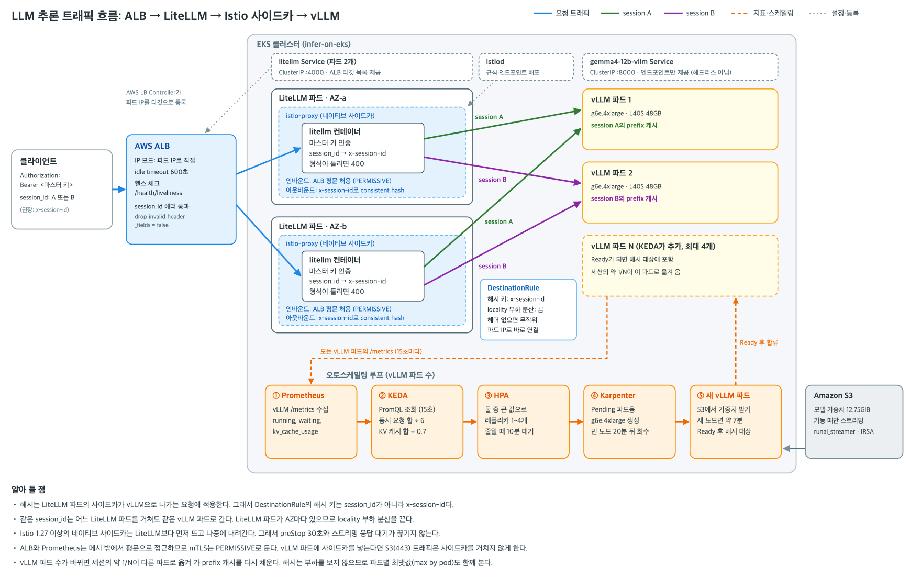

# infer-on-eks

_Work In Progress..._

### _Basic_ ###

* [C1. VPC 생성하기](https://github.com/gnosia93/infer-on-eks/blob/main/lesson/1-create-vpc.md)

* [C2. EKS 클러스터 생성하기](https://github.com/gnosia93/infer-on-eks/blob/main/lesson/2-create-eks.md)

* [C3. GPU 스케줄링 설정](https://github.com/gnosia93/infer-on-eks/blob/main/lesson/3-gpu.md)
  
* C4. vLLM - Gemma4-12B 모델 배포
  * [모델 선정 기준 (Bedrock -> Open Weight)](https://github.com/gnosia93/infer-on-eks/blob/main/lesson/4-model-selection.md)
  * [모델 배포하기 - 디플로이먼트/서비스](https://github.com/gnosia93/infer-on-eks/blob/main/lesson/4-vllm.md)
  * [모델 레이턴시 측정](https://github.com/gnosia93/infer-on-eks/blob/main/lesson/4-vllm-latency.md)
    
* C5. 세션 / 트래픽 라우팅
  * [LiteLLM 배포하기](https://github.com/gnosia93/infer-on-eks/blob/main/lesson/5-litellm.md)
  * [Istio/Envoy - `x-sesssion-id` 기반 Consistent Hashing 라우팅](https://github.com/gnosia93/infer-on-eks/blob/main/lesson/5-istio.md)
  * [서비스 엔드 포인트 만들기 - ALB Ingress](https://github.com/gnosia93/infer-on-eks/blob/main/lesson/5-alb-ingress.md)

* C6. 콜드 스타트 해결
  * https://github.com/gnosia93/infer-on-eks/blob/main/lesson/s3_datasync_fast_model_loading.md 
  * https://github.com/gnosia93/infer-on-eks/blob/main/lesson/eks_s3_fast_model_loading_full_guide.md
  * https://github.com/gnosia93/infer-on-eks/blob/main/lesson/llm-coldstart-soci-blog-outline.md  
  * https://github.com/gnosia93/infer-on-eks/blob/main/lesson/llm-coldstart-soci-karpenter-v2.md 
  * [배포시간 최적화 - SOCI Parallel Pull](https://github.com/gnosia93/infer-on-eks/blob/main/lesson/4-vllm-optimized.md)
  * [GPU 노드 Pre Scaling](https://github.com/gnosia93/infer-on-eks/blob/main/lesson/6-auto-scaling.md)

* C7. KEDA (Kubernetes Event-Driven Autoscaling)
  * [Prometheus 설치하기](https://github.com/gnosia93/infer-on-eks/blob/main/lesson/7-keda-prometheus.md)
  * [KEDA 설치 및 ScaledObject 생성](https://github.com/gnosia93/infer-on-eks/blob/main/lesson/7-keda-install.md)
  * [vLLM 파드 스케일링 테스트](https://github.com/gnosia93/infer-on-eks/blob/main/lesson/7-keda-autoscaling-test.md)

* [C8. vLLM Network Policy](https://github.com/gnosia93/infer-on-eks/blob/main/lesson/8-cni-network-policy.md) 

* C9. LLM 성능 평가 및 보안
   * [promptfoo 로 모델 성능 평가하기](https://aws.amazon.com/ko/blogs/tech/bedrock-promptfoo-eval/)
   * llm 보안 취약점 스캔
    
### _Advanced_ ###
      
* [C10. LeaderWorkerSet (LWS) & Ray 인프라](https://github.com/gnosia93/infer-on-eks/blob/main/lesson/10-lws.md)
   * [ray 인프라](https://github.com/gnosia93/infer-on-eks/blob/main/lesson/2-ray.md)

* [C11. GPU 모니터링](https://github.com/gnosia93/infer-on-eks/blob/main/lesson/11.gpu-monitoring.md)

## Appendix ##

* [A1. Capcity Block](https://github.com/gnosia93/infer-on-eks/blob/main/lesson/a2-capacity-block.md)
* [A2. EFA 모니터링](https://github.com/gnosia93/infer-on-eks/blob/main/lesson/a2-efa-observability.md)
* [A3. lustre 설정](https://github.com/gnosia93/infer-on-eks/blob/main/lesson/5-create-lustre.md)
* [A4. MIG & DRA](https://github.com/gnosia93/infer-on-eks/blob/main/lesson/9-dra.md)

